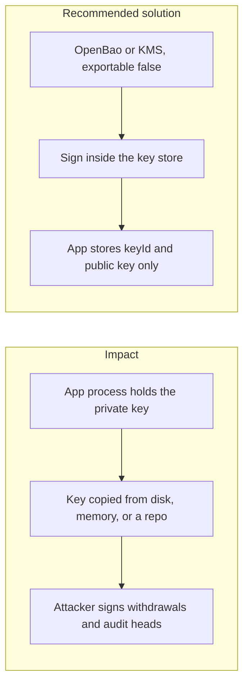

# 001. Private Key Storage

## Problem

The application has to sign audit checkpoints, payment requests, and withdrawals. The private key that produces those signatures has to live somewhere. Putting it in source code, an environment file, a container image, browser storage, or a PostgreSQL column (even an encrypted one) makes every copy of that artifact a copy of the key.

## Impact

- A leaked key lets an attacker sign withdrawals, webhook payloads, or signed tree heads that verifiers will accept.
- Keys in git history stay exposed after the file is deleted.
- A database backup becomes a key backup, so a stolen snapshot is enough to forge signatures.
- Client-side custody keys in `localStorage` are readable by any script that runs in the page.

## Recommended solution

Signing and key derivation go through a `Signer` interface. The dev backend is OpenBao Transit. Production is AWS KMS, CloudHSM, or an equivalent HSM. Keys are created with `exportable: false`. The app stores `keyId` (with version) and the public key. It never stores private keys or seed phrases in code, env vars, config, images, or PostgreSQL. Browser wallets, when the product uses them, keep keys in the wallet, not in page storage.
