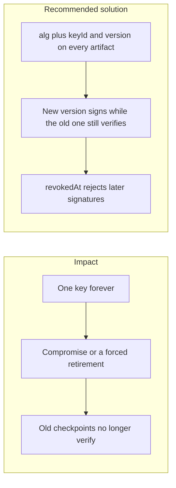

# 002. Key Lifecycle Management

## Problem

Keys have to rotate and, when compromised, be revoked. A rotation that deletes the old key makes historical signed tree heads and payment records unverifiable. A rotation that keeps accepting the old key after revocation leaves a stolen key useful. Re-encrypting data under a new key during a live request path stalls users.

## Impact

- Users and regulators cannot prove an old audit head was signed by us.
- A revoked key still accepted after `revokedAt` keeps authorizing fraud.
- A big-bang re-encryption locks accounts for the length of the job.
- Dual-running two algorithms without a version on the artifact makes verifiers guess, and guess wrong.

## Recommended solution

Every signed artifact stores `alg` (for example `ed25519` or `ml-dsa-65`) and `keyId` including the key version. Rotation publishes a new version and signs new artifacts with it. Verification uses the public key of the exact version named on the artifact, so old checkpoints stay valid. If `revokedAt` is set, verification returns false for signatures after that time and still accepts earlier ones when an external time anchor covers them. Re-encryption of data keys runs as a background job, not on the request that the user is waiting on.
