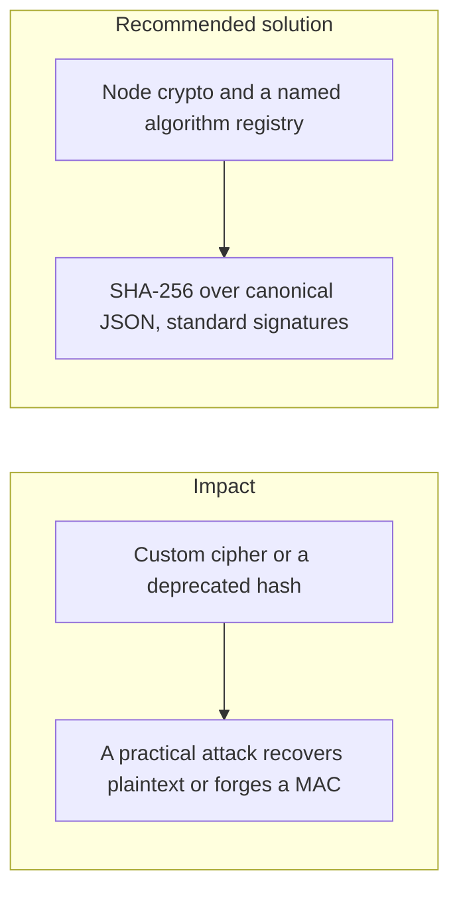
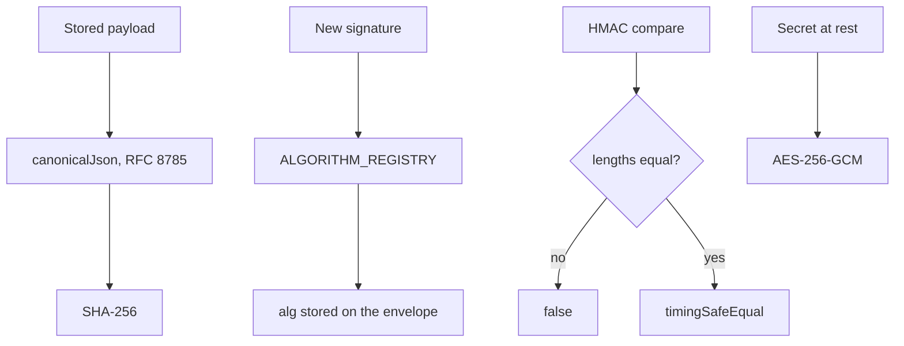

# 003. Misuse of Cryptographic Primitives and Libraries



## Problem

Teams pick MD5, SHA-1, or a hand-rolled cipher because it is short to write, or they call a solid library with the wrong construction. "Encryption" that is really Base64, and a MAC compared with `===`, are the same class of mistake. The algorithm looks present in a review and fails in an attack.

## Impact

- Forged audit hashes or webhook MACs that the server accepts.
- Collisions on identifiers that were only hashed, not keyed.
- A library upgrade that changes a default and silently weakens every new signature.
- No way to migrate later, because the artifact does not record which algorithm produced it.

## Recommended solution

Use Node `crypto` and the constructions already fixed for this platform: SHA-256 over canonical JSON (RFC 8785), detached signatures through the `Signer`, and `crypto.timingSafeEqual` for MAC and signature compares. Do not invent ciphers, modes, or paddings. Register allowed algorithms in one place and store `alg` on every artifact. Dependency review rejects packages whose only job is to wrap a deprecated hash.

## Code



`canonicalJson` is RFC 8785, and `canonicalJsonSha256` hashes that string with SHA-256. `ALGORITHM_REGISTRY` is the only list of signing algorithms. HMAC API clients compare with `timingSafeEqual` after a length check. Secrets at rest use `createCipheriv('aes-256-gcm', ...)`, not a hand-rolled mode.

```typescript
export function canonicalJsonSha256(value: unknown): string {
  return createHash('sha256')
    .update(canonicalJson(value), 'utf8')
    .digest('hex');
}
```

```typescript
export const ALGORITHM_REGISTRY: Readonly<Record<SigningAlg, AlgorithmSpec>> = {
  ed25519: { digest: null, signatureBytes: { min: 64, max: 64 } },
  'ecdsa-p256': { digest: 'sha256', signatureBytes: { min: 8, max: 72 } },
  'ml-dsa-65': { digest: null, signatureBytes: { min: 3309, max: 3309 } },
};
```

```typescript
return (
  signature.length === expected.length &&
  timingSafeEqual(signature, expected)
);
```
