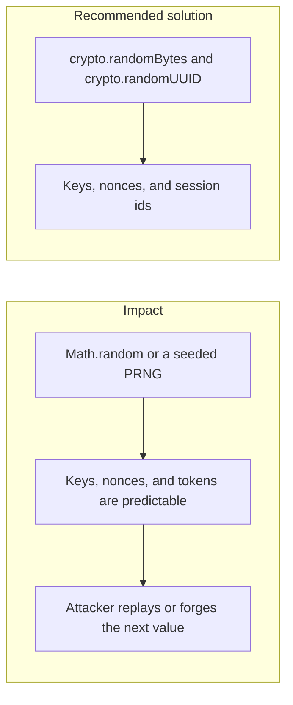

# 004. Weak Random Number Generation

## Problem

`Math.random`, a timestamp, or a PRNG seeded by the developer is fine for shuffling a demo list. It is not fine for key material, nonces, idempotency fallbacks, password-reset tokens, or API client secrets. Several of the most common cryptographic weaknesses in the OWASP 2025 data are exactly this: the generator was never meant to be unpredictable.

## Impact

- An observer predicts the next nonce and replays or pre-plays a signed request.
- Reset tokens and session identifiers are guessable, so accounts are taken over without a password.
- Two processes that share a weak seed produce the same "unique" id and collide on a money movement.
- Key generation that looks random in tests is biased in production.

## Recommended solution

Draw secrets only from Node `crypto.randomBytes` and `crypto.randomUUID`. Do not seed that generator. Idempotency keys and nonces are those values, stored in Redis with AOF so they survive a restart, with a TTL longer than the signature time window. Tests that need determinism inject a fake random source at the boundary. Production code does not.
