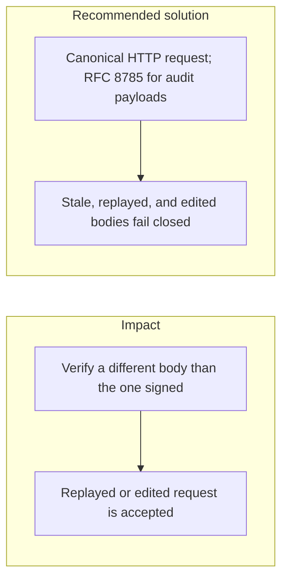

# 005. Signature and Nonce Mismatches

## Problem

A signature is only meaningful over the exact bytes the signer saw. Parsing JSON, re-serializing it with different key order, or dropping a field before verify makes a valid signature cover a different payment. Nonces and timestamps stop replay only when the same window is enforced on every hop, including after a process restart.

## Impact

- A captured signed request is sent again and pays twice.
- A proxy or client reorders JSON fields and the signature either fails closed for honest users or, worse, is checked against a rebuilt body an attacker edited.
- ECDSA signatures that are not checked for malleability verify more than once for one intent.
- Clock skew between the signer and the API makes fresh requests look expired. See [009. Trusted time and clock skew](009_trusted_time_and_clock_skew.md).

## Recommended solution

Sign each B2B HTTP request as a canonical request: method, path, timestamp, nonce, and `hex(sha256(raw body))`, separated by newlines. That covers the route and the raw bytes, so a re-encoded JSON body cannot move under the signature. Store used nonces in Redis with AOF persistence so a restart does not forget them. Reject a stale timestamp, a reused nonce, and any raw body that does not match the signed hash. Compare signatures with `crypto.timingSafeEqual`. Stored audit payloads use RFC 8785 (`canonicalJson`). This is the same rule as problem 2.13 in the build plan: replay, a stale timestamp, and a modified body are all rejected, including after a restart.
