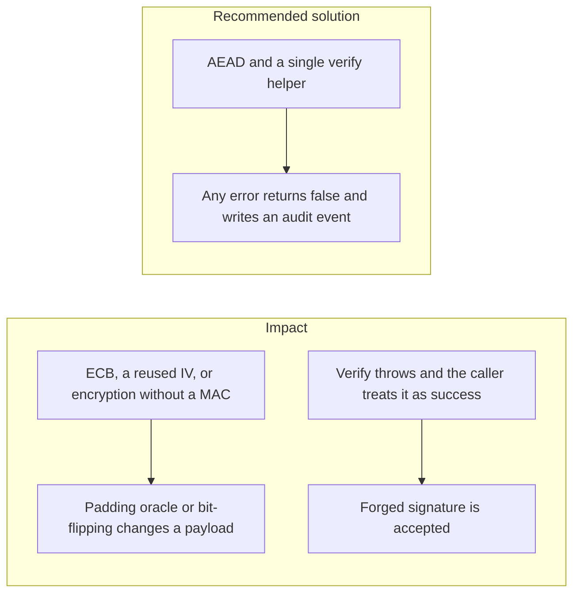
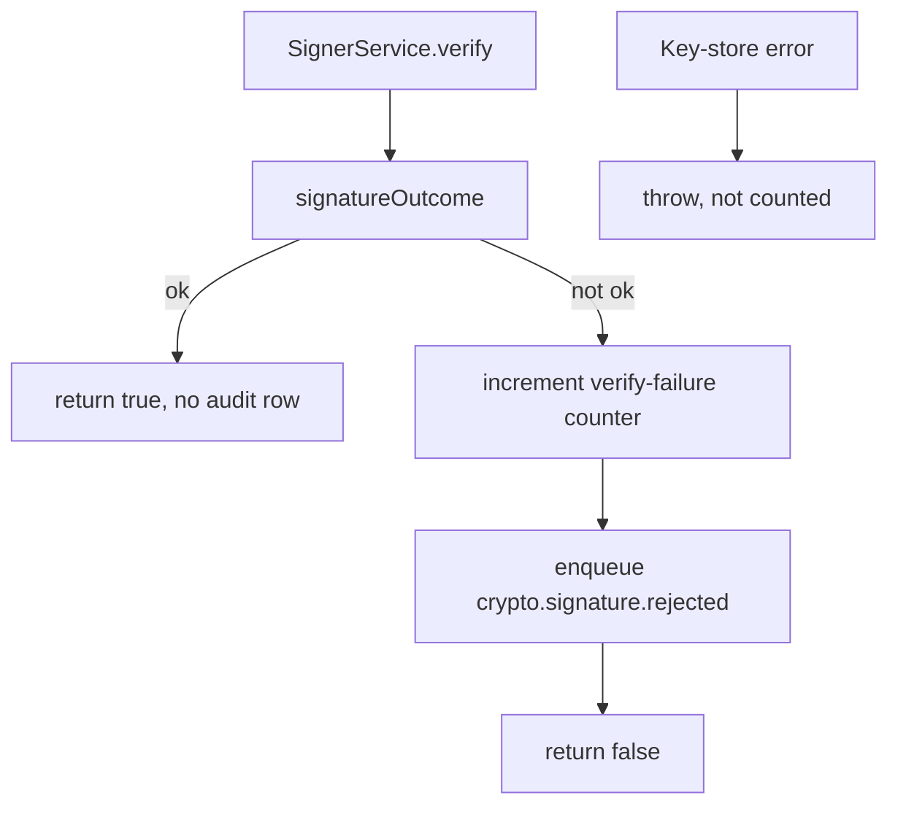

# 006. Low-Level Cryptographic Implementation Failures



## Problem

Choosing AES or Ed25519 does not finish the job. ECB mode leaks patterns. A reused initialization vector under CTR or GCM breaks confidentiality and, for GCM, can break authentication. Encryption without a MAC lets an attacker flip bits. A password used raw as a key is low entropy. A `catch` around `verify` that returns true, or that returns the decrypted blob anyway, fails open.

## Impact

- Account numbers or amounts are changed in transit and still decrypt.
- A padding error message becomes an oracle that recovers plaintext.
- A thrown error from a bad signature is logged and then ignored, so the withdrawal proceeds.
- Two ciphertexts under one IV let an attacker XOR them into a known pattern.

## Recommended solution

Use authenticated encryption for data at rest that the app itself encrypts, with a fresh random IV per message stored next to the ciphertext. Do not use ECB. Derive keys with a password-based key derivation function only when the input is a password. Route every signature check through one helper: malformed input, unknown `keyId`, and key-store errors throw a dedicated exception or return false, and they never return true. Record the failure on the audit stream. Compare tags with `crypto.timingSafeEqual`.

## Code



`SignerService.verify` is the only signature check. A key-store error still throws and is not counted or audited. Every false return increments `fintech_signature_verify_failures_total`, then enqueues `crypto.signature.rejected` schema version 1 on `auth.outbox` in its own short transaction. The chainer appends that row to `audit.audit_events`. A true verify writes nothing. If the outbox insert throws, the failure is logged and `verify` still returns false.

The reason is `malformed` when the envelope does not parse, `revoked` when the catalog key is revoked and the stored time anchor does not cover `signedAt`, `unknown_key` when no catalog row exists and the signature does not match, and `mismatch` when a published key's signature does not match. `keyId` is included only after the envelope parses. The signature bytes, the payload, and secrets are omitted. The schema is strict, so an extra `sig` field is rejected.

```typescript
const outcome = await this.signatureOutcome(bytes, signature, anchor);
if (outcome.ok) return true;
this.metrics?.recordSignatureVerifyFailure();
await this.recordRejection(outcome);
return false;
```

```typescript
await prisma.withTx((tx) =>
  outbox.enqueue(tx, 'auth', {
    type: 'crypto.signature.rejected',
    schemaVersion: 1,
    occurredAt: new Date().toISOString(),
    actor: { subjectRef: SIGNER_ACTOR },
    ...(requestId !== undefined ? { requestId } : {}),
    ...(keyId !== undefined && PARTITION_KEY.test(keyId)
      ? { partitionKey: keyId }
      : {}),
    reason: rejection.reason,
    ...(keyId !== undefined ? { keyId } : {}),
  }),
);
```

```typescript
export const SIGNATURE_REJECTION_REASONS = [
  'malformed',
  'unknown_key',
  'revoked',
  'mismatch',
] as const;
```

```typescript
reason: z.enum(SIGNATURE_REJECTION_REASONS),
keyId: z.string().min(1).max(96).optional(),
```
