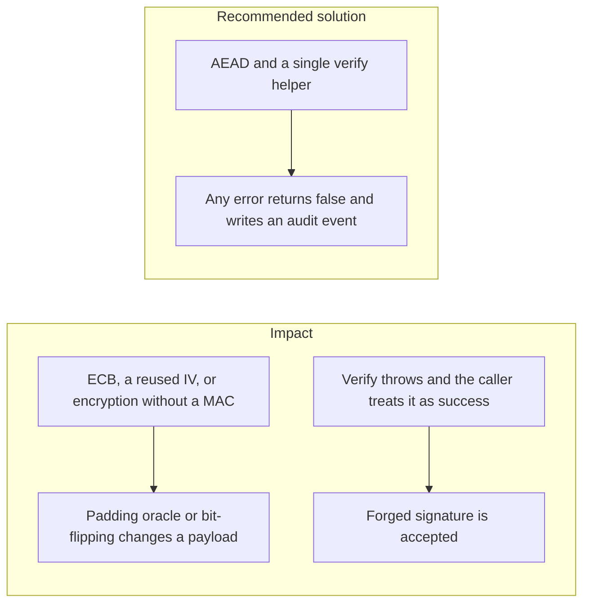

# 006. Low-Level Cryptographic Implementation Failures

## Problem

Choosing AES or Ed25519 does not finish the job. ECB mode leaks patterns. A reused initialization vector under CTR or GCM breaks confidentiality and, for GCM, can break authentication. Encryption without a MAC lets an attacker flip bits. A password used raw as a key is low entropy. A `catch` around `verify` that returns true, or that returns the decrypted blob anyway, fails open.

## Impact

- Account numbers or amounts are changed in transit and still decrypt.
- A padding error message becomes an oracle that recovers plaintext.
- A thrown error from a bad signature is logged and then ignored, so the withdrawal proceeds.
- Two ciphertexts under one IV let an attacker XOR them into a known pattern.

## Recommended solution

Use authenticated encryption for data at rest that the app itself encrypts, with a fresh random IV per message stored next to the ciphertext. Do not use ECB. Derive keys with a password-based key derivation function only when the input is a password. Route every signature check through one helper: malformed input, unknown `keyId`, and key-store errors throw a dedicated exception or return false, and they never return true. Record the failure on the audit stream. Compare tags with `crypto.timingSafeEqual`.
