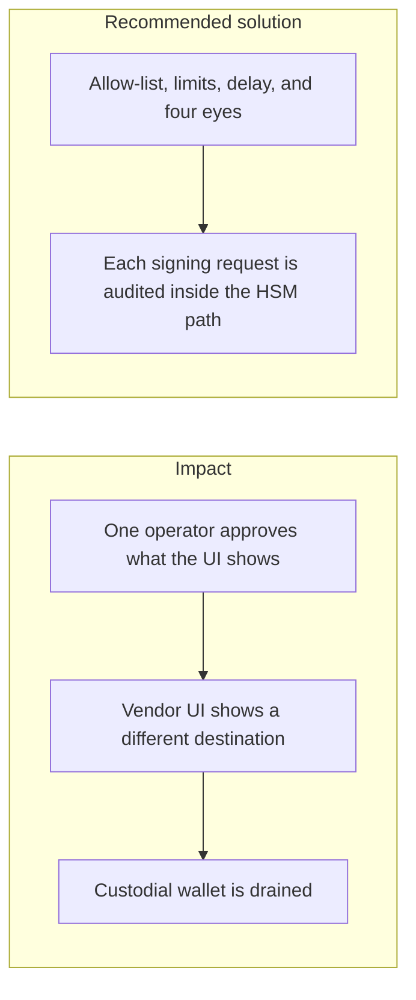
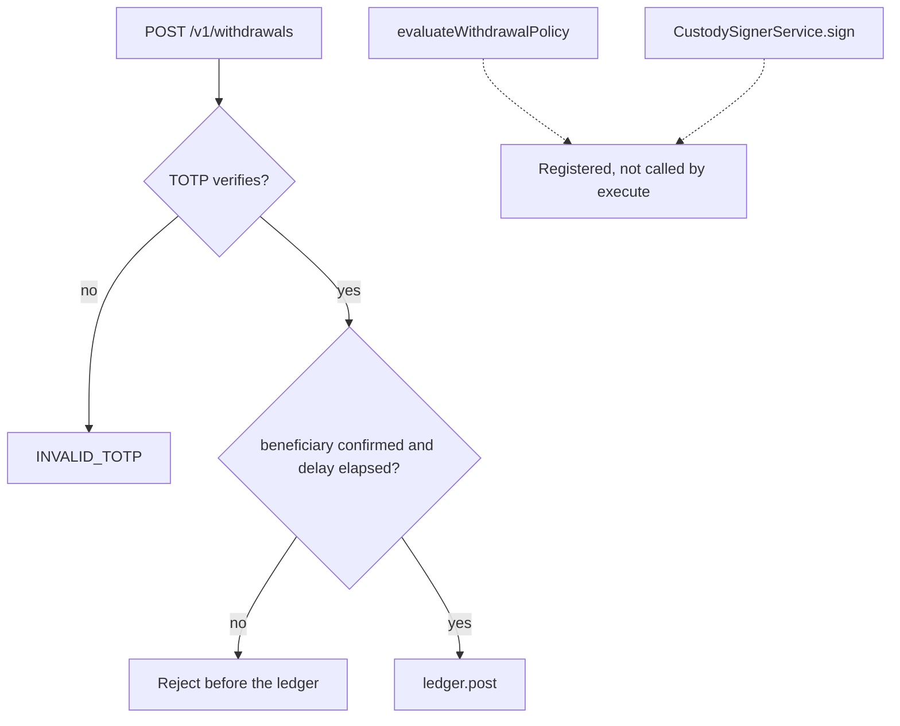

# 007. Operational Key Compromise and Approval Integrity



## Problem

Most centralized-exchange losses come from a key that was used, not from a weak algorithm. One operator, a shared break-glass credential, or an approval screen supplied by a vendor is enough. In 2025 the largest exchange theft changed what operators saw on a multisig approval screen while the signed payload sent funds elsewhere.

## Impact

- A single phished operator moves the whole hot wallet.
- The audit log says "approved" and the on-chain transfer does not match the amount or address the operator read.
- A backup of the seed, stored in a chat or a ticket, is the key.
- There is no delay in which a second person can stop the withdrawal.

## Recommended solution

Custody withdrawals on this platform use non-exportable keys and enforce an address allow-list, amount limits, a delay, and four-eyes approval before the `Signer` is called. Every signing request is written to the append-only audit log. The approver confirms the canonical destination and amount, not a vendor-rendered summary alone. Seeds and private keys are not exported into the app database or into operator laptops.

## Code



`POST /v1/withdrawals` calls `requireActive` before `ledger.post`. A beneficiary is active only after confirmation and `BENEFICIARY_ACTIVATION_DELAY_HOURS`. `evaluateWithdrawalPolicy` rejects self-approval, a daily-limit breach, and returns `require_approval` or `delay` for large amounts. `CustodySignerService.sign` signs the canonical payload and enqueues `custody.sign` with `keyId` and `alg`. That policy and that signer are registered on the module. `WithdrawalsService.execute` does not call either of them. The payout that runs today is TOTP, the allow-list, the activation delay, and the ledger post.

```typescript
if (input.approverId !== undefined && input.approverId === input.requesterId)
  return { action: 'reject', reason: 'SELF_APPROVAL' };
```

```typescript
if (input.amount.gte(limits.approvalThreshold))
  return { action: 'require_approval', reason: 'ABOVE_THRESHOLD' };
```

```typescript
await this.prisma.withTx(async (tx) => {
  await this.outbox.enqueue(tx, 'withdrawals', {
    type: 'custody.sign',
    schemaVersion: 1,
    occurredAt,
    actor: { subjectRef: request.actorId },
    ...(requestId !== undefined ? { requestId } : {}),
    partitionKey: request.actorId,
    operationId: request.operationId,
    operationType: request.operationType,
    payloadHash,
    keyId: signature.keyId,
    alg: signature.alg,
  });
});
```
