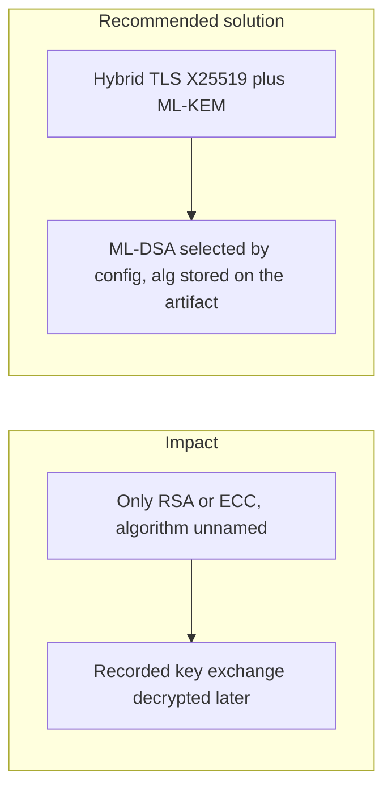

# 008. Post-Quantum Readiness and Cryptographic Agility

## Problem

A cryptographically relevant quantum computer has not broken production fintech systems. Someone who records today's public-key traffic can keep it until one does. Systems that hard-code RSA or a single curve, and that do not store which algorithm signed an artifact, cannot migrate without a rewrite. The March 2026 European Payments Council guidelines treat that migration as design work to do now.

## Impact

- Long-lived secrets (card data, identity documents, signed instructions) become readable when the recorded key exchange falls.
- Historical signatures cannot be re-verified under a new algorithm because `alg` was never stored.
- A rushed cutover breaks verification of old checkpoints.
- Teams discover the inventory of algorithms only during an incident.

## Recommended solution

Keep a cryptographic bill of materials. Every signature stores `alg` and `keyId`. ML-DSA is selected by configuration, not by a scattered code change. Edge TLS is hybrid: X25519 together with ML-KEM. Classical signatures stay in place until verifiers for the post-quantum algorithm are deployed, so old artifacts keep verifying under the algorithm they name.
