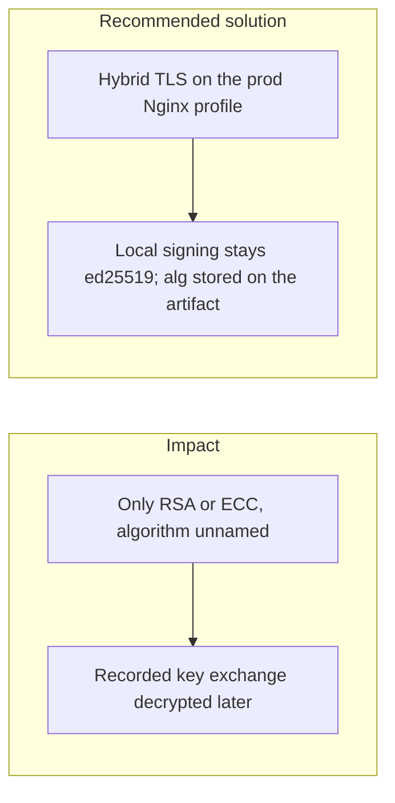
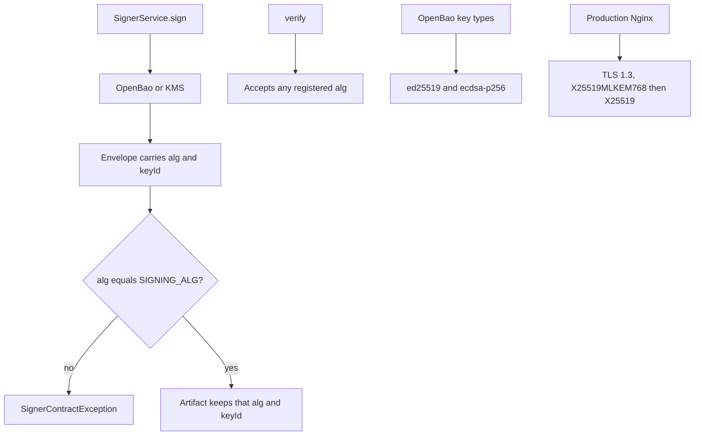

# 008. Post-Quantum Readiness and Cryptographic Agility



## Problem

A cryptographically relevant quantum computer has not broken production fintech systems. Someone who records today's public-key traffic can keep it until one does. Systems that hard-code RSA or a single curve, and that do not store which algorithm signed an artifact, cannot migrate without a rewrite. The March 2026 European Payments Council guidelines treat that migration as design work to do now.

## Impact

- Long-lived secrets (card data, identity documents, signed instructions) become readable when the recorded key exchange falls.
- Historical signatures cannot be re-verified under a new algorithm because `alg` was never stored.
- A rushed cutover breaks verification of old checkpoints.
- Teams discover the inventory of algorithms only during an incident.

## Recommended solution

Keep a cryptographic bill of materials. Every signature stores `alg` and `keyId`, and verification accepts the algorithm the artifact names, so old checkpoints stay verifiable. Local signing stays ed25519: OpenBao 2.7 Transit cannot sign ML-DSA, and the signer must not claim a signature that key store did not create. ML-DSA stays in the registry for a later key store. Edge TLS on the production Nginx profile is hybrid, X25519 together with ML-KEM. The local dev server does not serve that profile.

## Code



Every envelope stores `alg` and `keyId`. `SignerService.sign` throws when the adapter's `alg` is not the configured `SIGNING_ALG`. Verification still accepts any registered `alg`. OpenBao's map has `ed25519` and `ecdsa-p256` only. AWS KMS maps `ML_DSA_65` to `ml-dsa-65`. Nginx on the prod profile is TLS 1.3 with `X25519MLKEM768` first.

```typescript
export interface SignatureEnvelope {
  alg: SigningAlg;
  keyId: string;
  sig: string;
}
```

```typescript
if (envelope.alg !== this.signingAlg)
  throw new SignerContractException(
    `signed with ${envelope.alg}, configured SIGNING_ALG is ${this.signingAlg}`,
  );
```

```typescript
const ALG_OF_KEY_TYPE: Readonly<Record<string, SigningAlg>> = {
  ed25519: 'ed25519',
  'ecdsa-p256': 'ecdsa-p256',
};
```

```nginx
ssl_protocols TLSv1.3;
ssl_ecdh_curve X25519MLKEM768:X25519;
```
