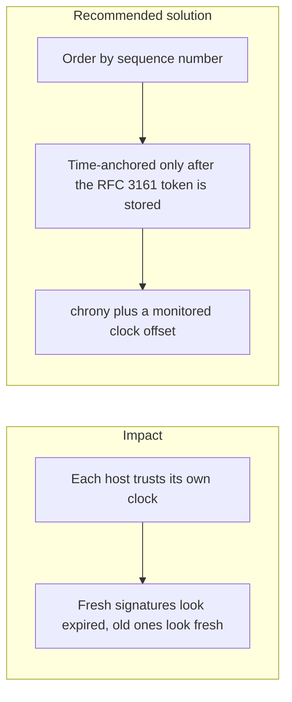

# 009. Trusted Time and Clock Skew



## Problem

Signature expiry, one-time codes, certificate validity, idempotency windows, and audit order all depend on time. Browser clocks, app servers, HSMs, and database hosts drift. Sorting an audit log by `created_at` then hides a gap that a sequence number would show. A timestamp the signer wrote is not evidence that a third party saw the data at that moment.

## Impact

- Honest payments fail because the API clock is ahead of the client.
- An attacker replays a request inside a window that a slow clock still calls fresh.
- Two partitions disagree about which withdrawal happened first.
- A regulator cannot show that a checkpoint existed before a later edit.

## Recommended solution

Order audit and money events by a per-partition sequence number, not by timestamp alone. Put an RFC 3161 timestamp token on every signed tree head (FreeTSA in dev, a qualified TSA in production). If the TSA call fails, store the signed head and retry the stamp off the transfer request, so the chain keeps moving. A head counts as time-anchored only after that token is stored. Run chrony on the hosts and alert when the clock offset exceeds the threshold already scraped for this platform. Nonce and signature windows are wider than measured skew and shorter than a useful replay.

## Code

`CheckpointerService.build` inserts the signed tree head, then calls `TsaService.stampTreeHead`. A TSA error increments `fintech_tsa_failures_total` and leaves the row in place with `tsa_token` empty, so the chain still moves. `SthService.latest` returns that head with `timeAnchored: false`. `timeAnchored` becomes true only after `stampTreeHead` stores a non-empty token. Inclusion proofs still use the latest signed head. `SthReceiptsService.pushLatest` writes a receipt only for `latestAnchored()`, the newest head whose token is already stored.

```typescript
async latestAnchored(): Promise<TreeHeadDto> {
  const rows = await this.prisma.treeHead.findMany({
    where: { tsaToken: { not: null } },
    orderBy: { treeSize: 'desc' },
  });
  const row = rows.find((candidate) => storedTsaToken(candidate.tsaToken));
  if (!row)
    throw new NotFoundException('no time-anchored tree head published yet');
  return toDto(row);
}

export function storedTsaToken(token: Uint8Array | null | undefined): boolean {
  return token != null && token.length > 0;
}
```

```typescript
hasTsaToken: storedTsaToken(row.tsaToken),
timeAnchored: storedTsaToken(row.tsaToken),
```
