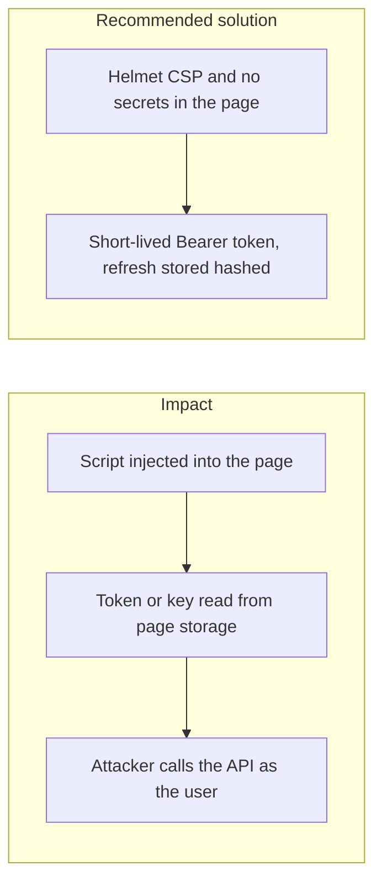
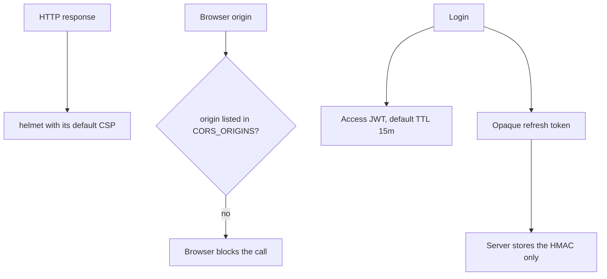

# 010. Client-Side Attacks (XSS and CSRF)



## Problem

A fintech page that renders untrusted text as HTML, or that stores a session secret where any script can read it, gives that script the user's authority. CSRF matters when the browser attaches the credential automatically. XSS matters even for Bearer tokens if the token sits in `localStorage` or in the DOM.

## Impact

- The script initiates a transfer or reads a statement while the user is logged in.
- A stolen access token is replayed until it expires.
- A wallet key kept in the page is exported.
- A malicious extension or injected script changes the amount after the user typed it and before the request is signed.

## Recommended solution

Render text as text. Helmet sets the content-security policy. This app's Swagger UI loads only external scripts, so the policy does not grow exceptions for inline script. Access tokens are 15-minute Bearer JWTs. Refresh tokens are opaque, stored only as an HMAC, and rotated. Do not put private keys or refresh tokens in `localStorage`. State-changing routes require the Bearer token. Cookie-based sessions, if added later, use `SameSite`, `HttpOnly`, and a CSRF token.

## Code



`setupApp` calls `helmet()` with no extra script sources, then CORS from `CORS_ORIGINS`. There is no web client and no `localStorage` in this repository. Access TTL defaults to `15m`. The server stores `hashRefreshToken`, an HMAC of the opaque token, and returns the token in the JSON body. Cookie sessions are not implemented.

```typescript
app.use(helmet());
app.enableCors({
  origin: config.get('CORS_ORIGINS', { infer: true }).split(','),
  credentials: true,
  exposedHeaders: [
    'x-request-id',
    'retry-after',
    'x-ratelimit-limit',
    'x-ratelimit-remaining',
    'x-ratelimit-reset',
  ],
});
```

```typescript
hashRefreshToken(token: string): string {
  return createHmac('sha256', this.refreshKey).update(token).digest('hex');
}
```
