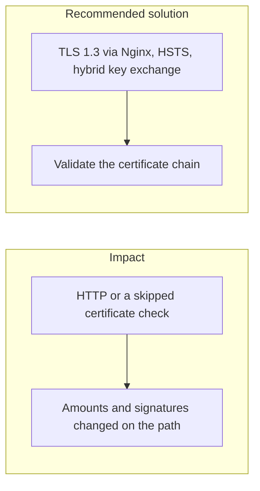

# 011. Man-in-the-Middle and Transport-Layer Risks

## Problem

Money instructions and signed bodies are only protected if the transport that carries them is authenticated and encrypted. Accepting HTTP, disabling certificate checks in a mobile client, or pinning a leaf certificate that then rotates, each breaks that guarantee in a different way.

## Impact

- A network attacker reads PANs, tokens, or signed instructions.
- A tampered response shows a false balance or a false "payment succeeded".
- A pinned certificate expires and the app fails for every user, which trains people to bypass the check.
- Downgrade to an old TLS version weakens the key exchange that post-quantum hybrid mode was meant to protect.

## Recommended solution

Terminate TLS on Nginx and send HSTS. Prefer TLS 1.3 and validate the full certificate chain. Production hybrid mode negotiates X25519 together with ML-KEM, as in the platform's post-quantum control. On the web, do not pin leaf certificates. Certificate pinning stays a mobile control, with a backup pin and a planned rotation. Application-layer signatures (request signing, webhook MACs) still cover the body so a terminated TLS hop is not the only check.
