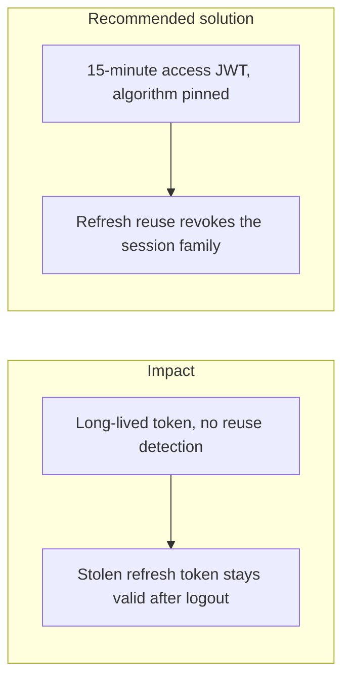

# 012. Flawed Session and Identity Management

## Problem

Sessions fail when tokens live too long, when logout does not invalidate them, when the server accepts any JWT algorithm the header names, or when a stolen refresh token can be used beside the real user's new one. "Logged out" on the client is not logout if the server still honors the token.

## Impact

- Account takeover that survives a password change.
- A leaked token in a log or a browser extension keeps working for days.
- An `alg: none` or algorithm-confusion token is accepted.
- Two devices share one refresh token and a theft on one is invisible on the other.

## Recommended solution

Access tokens last 15 minutes, are HS256, and verification pins `algorithms: ['HS256']` with issuer and audience. Refresh tokens are 256-bit opaque values. The server stores only an HMAC. Rotation detects reuse and revokes the whole session family. Logout invalidates that family. Passwords use Argon2id via `node:crypto`. Global `JwtAuthGuard` and `RolesGuard` deny every route that is not marked `@Public()`.
