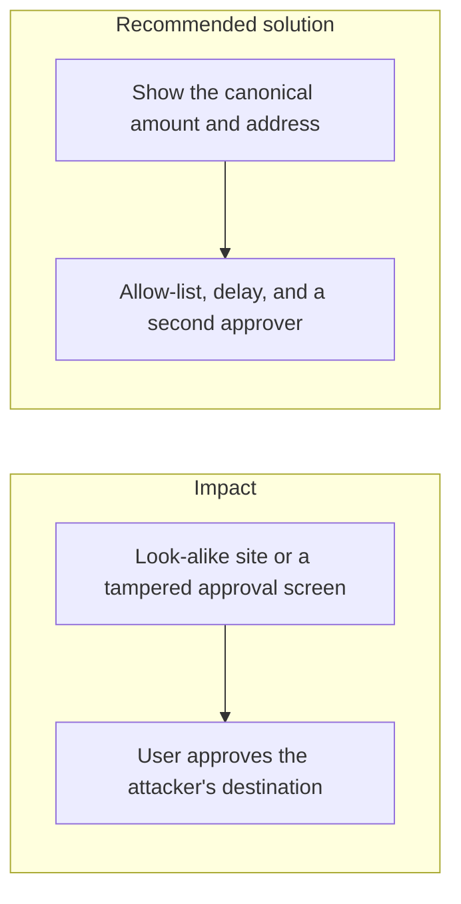
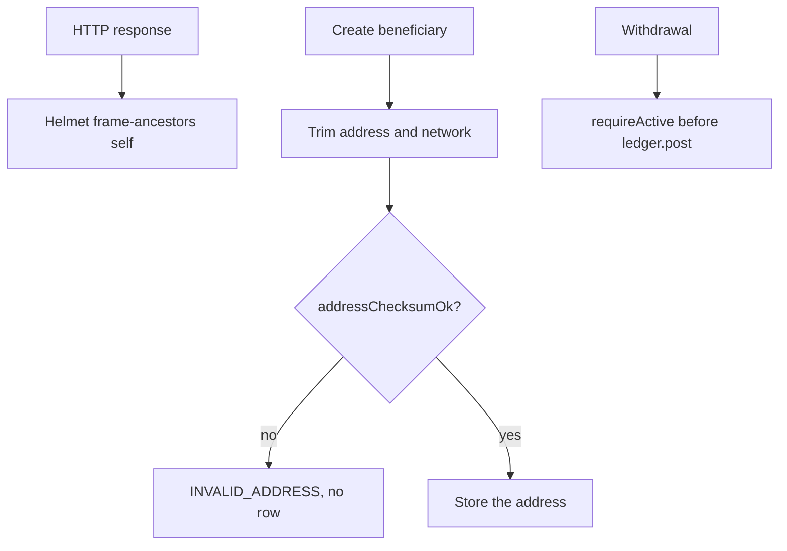

# 013. Phishing and UI Spoofing



## Problem

Users authorize what they see. A look-alike domain, a clickjacked button, a browser extension, or a vendor UI that was modified can show "pay Alice 10" while the signed payload pays someone else 10,000. This is the same failure mode as an operational signing screen that does not match the bytes.

## Impact

- The user authorizes a withdrawal to an attacker and the ledger is correct about a wrong intent.
- Support staff reset credentials because a deepfake or a copied site asked them to.
- Framed pages capture TOTP codes.
- A wallet extension swaps the recipient after the review screen.

## Recommended solution

Serve the app only from the real origin, with frame-ancestors locked down by Helmet. Withdrawals show the canonical address and decimal amount that will be signed, then wait out the custody delay. High-value sends require a second approver and an allow-listed destination. The server rejects a body that does not match that canonical form. Teach users the origin. Do not ask them to read a seed phrase into a web form.

## Code



`setupApp` calls `helmet()` with no custom frame policy, so Helmet's defaults apply (`frame-ancestors 'self'` and `X-Frame-Options: SAMEORIGIN`). There is no page in this repository that shows an address before a signature. The server rejects a destination that fails `addressChecksumOk` before insert, and `requireActive` refuses a destination that is not confirmed and past the delay. A seed phrase is not an API field.

```typescript
app.use(helmet());
```

```typescript
const address = dto.address.trim();
const network = dto.network.trim().toLowerCase();
if (!addressChecksumOk(network, address)) throw invalidAddress();
```
