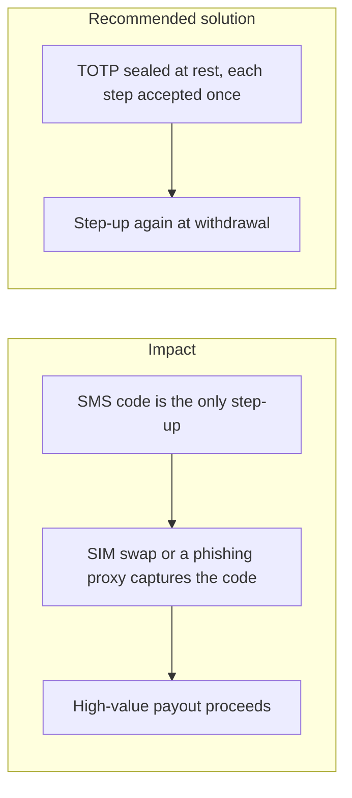
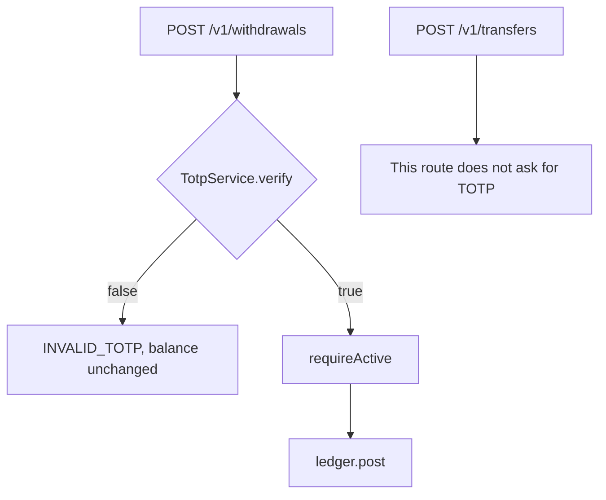

# 014. Multi-Factor Authentication Bypass



## Problem

A password plus an SMS code fails when the phone number is moved to another SIM, or when a real-time phishing site relays the code. MFA that is checked only at login, and not again for a withdrawal, does not protect the money movement. A TOTP code that can be replayed inside its 30-second window is a second password.

## Impact

- Account takeover of users whose carrier account was socially engineered.
- A code captured once is submitted twice, including by two concurrent requests.
- Support disables MFA from a chat message and the attacker adds their own factor.
- The TOTP secret sits in plaintext in the database and leaves with a backup.

## Recommended solution

TOTP is HMAC-based on `node:crypto` (6 digits, 30 seconds, one step of drift). The secret is sealed with AES-256-GCM, with the user id as additional authenticated data. Each time-step is accepted once, including under concurrent logins. Login requires the code after TOTP is enabled. A new withdrawal destination still needs a TOTP confirm and then the activation delay before it can be used. The withdrawal itself asks for a new code every time, including when that destination is already active, together with the four-eyes custody checks. Prefer this app-based factor over SMS for the step that moves money. Reset of an enabled factor is an audited admin action, not a self-serve toggle.

## Code



`POST /v1/withdrawals` (`withdrawals.create`) calls `TotpService.verify` before `LedgerService.post`. Confirm and the activation delay still gate a new address. Internal `transfers.create` does not ask for TOTP. A code that `verify` already claimed returns false, the handler throws `INVALID_TOTP`, and the wallet balance stays put.

```typescript
if (!(await this.totp.verify(userId, dto.totpCode))) throw invalidTotp();

const beneficiary = await this.beneficiaries.requireActive(
  userId,
  dto.beneficiaryId,
);
```

```typescript
await this.ledger.post(
  {
    ref,
    entries: [
      {
        accountId: wallet.ledgerAccountId,
        amount: amount.negate().toString(),
      },
      { accountId: clearing.id, amount: amount.toString() },
    ],
  },
  tx,
);
```
