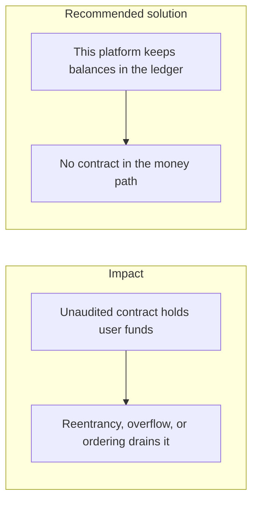
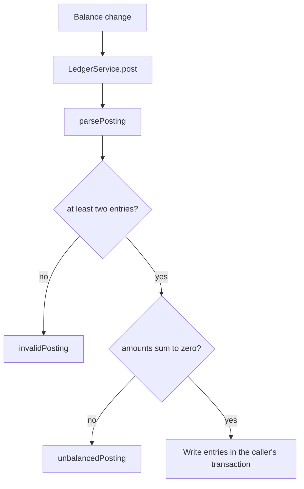

# 015. Smart Contract Vulnerabilities



## Problem

Reentrancy, integer overflow, and transaction-ordering attacks drain contracts that hold balances. They dominate losses on decentralized apps. They are not a property of a custodial web app that never deploys a contract. Adding one "just for deposits" pulls the whole class of bugs into the product.

## Impact

- Every user balance locked in the contract can leave in one transaction.
- A front-run changes the price or the recipient the user thought they accepted.
- The web app cannot reverse the chain transaction, so the ledger and the chain disagree.
- An upgrade key on the contract is a second custody key with weaker controls than the HSM.

## Recommended solution

This modular monolith records balances in the double-entry ledger and signs with OpenBao or a KMS. It does not put user funds in a contract. If a later product must talk to a chain, treat the contract as a new custody system: an external audit, explicit pause, upgrade keys in an HSM with four-eyes, and integer arithmetic in the contract's own units. The web tier still checks authorization, idempotency, and the ledger. It does not assume the contract is safe because the UI is.

## Code



There is no Solidity in this repository. `LedgerService.post` is the only code that changes a balance. `parsePosting` requires at least two entries whose amounts sum to zero before any row is written. A withdrawal payout calls that `post` inside the same transaction as the idempotency claim.

```typescript
post(
  input: PostingInput,
  tx?: Prisma.TransactionClient,
): Promise<PostingResult> {
  const posting = parsePosting(input);
  return tx
    ? this.postIn(tx, posting)
    : this.prisma.withTx((t) => this.postIn(t, posting));
}
```

```typescript
if (input.entries.length < 2)
  throw invalidPosting('entries', 'a posting needs at least two entries');
```

```typescript
const total = entries.reduce((s, e) => s.plus(e.amount), new Decimal(0));
if (!total.isZero()) throw unbalancedPosting(total.toFixed());
```
