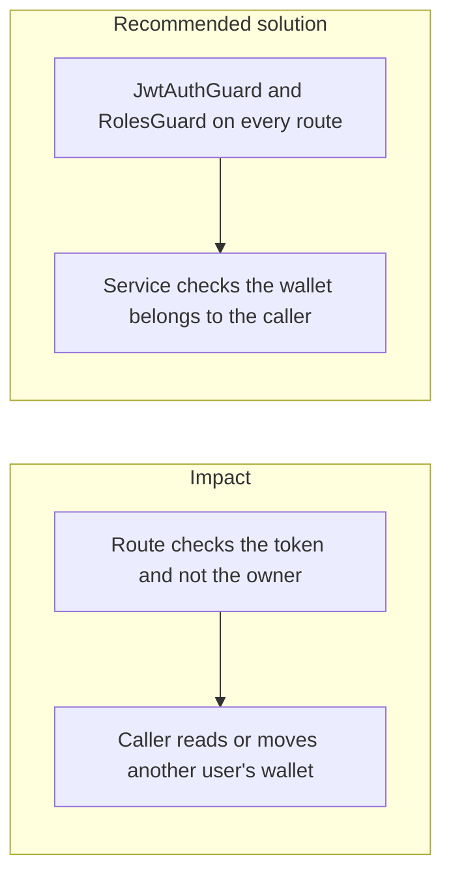

# 016. Broken Access Control



## Problem

A valid login is not permission to act on every row. Object-level failures (IDOR / BOLA) are the top web risk in OWASP 2025. On a money API they look like `GET /v1/wallets/{id}` or `POST /v1/transfers` where the source wallet id is someone else's. Hiding the button is not a control.

## Impact

- One user lists another user's balance or statement.
- A transfer debits a wallet the caller does not own.
- A support role reaches an admin export because the role check is only in the UI.
- A `@Public()` webhook or health route is copied onto a money route and skips the guard.

## Recommended solution

`JwtAuthGuard` and `RolesGuard` are global. A route is anonymous only with `@Public()`, and that list stays limited to health, docs in non-production, login, and signature-checked webhooks. The transfer service rejects a source wallet that is not the caller's, in the same transaction as the movement. Privileged routes (`approver`, `compliance`, `admin`) read the role from the database on that request, so a demotion applies before the 15-minute access token expires. The token still proves identity, and the client cannot widen the role claim. Tests call each money route with a second user's id and expect a denial.

## Code

`RolesGuard` keeps the access token as the proof of identity. When `@Roles()` intersects `approver`, `compliance`, or `admin`, it loads `auth.users.roles` for that user and decides from the row. A missing user or a role that is no longer on the row is 403. A route that only requires `user` still uses the token. TOTP is still required when every granted role is privileged.

```typescript
private async rolesFor(
  userId: string,
  tokenRoles: Role[],
  required: Role[],
): Promise<Role[] | null> {
  if (!required.some((role) => PRIVILEGED_ROLES.includes(role)))
    return tokenRoles;
  const stored = await this.users.rolesOf(userId);
  if (!stored) return null;
  return stored.filter((role): role is Role =>
    (ROLES as readonly string[]).includes(role),
  );
}
```

`UsersService.rolesOf` selects only `roles`. After `prisma.user.update` drops `admin`, the same access token receives 403 on the privileged route and 200 on `GET /v1/wallets`.
