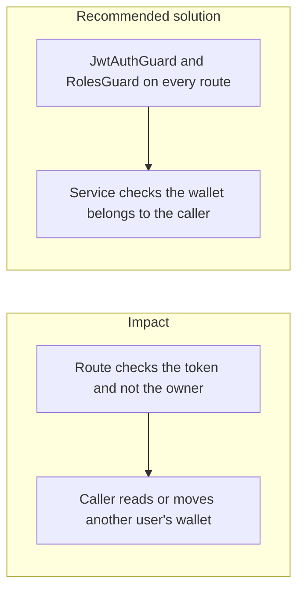

# 016. Broken Access Control

## Problem

A valid login is not permission to act on every row. Object-level failures (IDOR / BOLA) are the top web risk in OWASP 2025. On a money API they look like `GET /v1/wallets/{id}` or `POST /v1/transfers` where the source wallet id is someone else's. Hiding the button is not a control.

## Impact

- One user lists another user's balance or statement.
- A transfer debits a wallet the caller does not own.
- A support role reaches an admin export because the role check is only in the UI.
- A `@Public()` webhook or health route is copied onto a money route and skips the guard.

## Recommended solution

`JwtAuthGuard` and `RolesGuard` are global. A route is anonymous only with `@Public()`, and that list stays limited to health, docs in non-production, login, and signature-checked webhooks. The transfer service rejects a source wallet that is not the caller's, in the same transaction as the movement. Admin actions use `@Roles` checked against the role stored for that user, not a role claim the client can widen. Tests call each money route with a second user's id and expect a denial.
