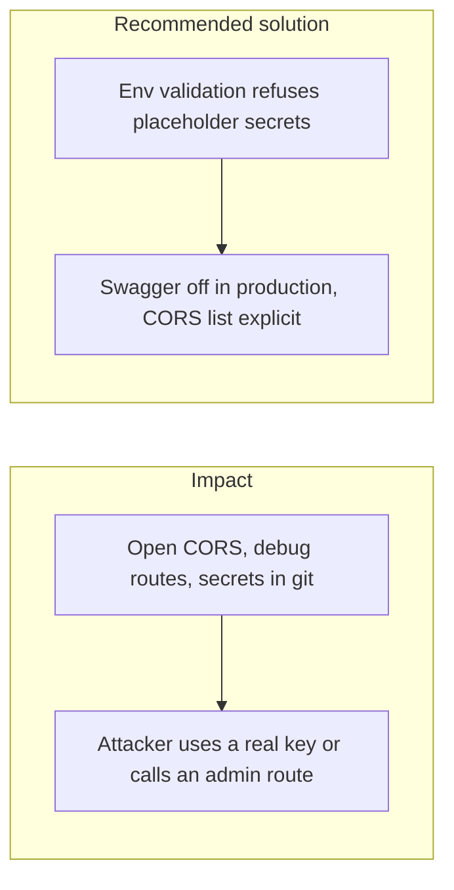

# 017. Security Misconfiguration and Leaked Secrets

## Problem

The defaults that make local development easy are the ones that leak in production: CORS `*`, Swagger left on, a `change-me` JWT secret, a public object bucket, verbose errors that include a stack and a SQL fragment, and API keys committed next to `.env.example`.

## Impact

- Anyone who can load the front end can call the API from their origin.
- A token signed with the sample secret is accepted.
- A database URL or webhook secret in git history is valid until someone rotates it.
- An error response teaches an attacker the query that failed.

## Recommended solution

`ConfigModule` validation requires secrets of at least 32 characters and rejects the placeholder `change-me`. It reports the variable name, never the value. `CORS_ORIGINS` is an explicit list. Swagger is served only when `NODE_ENV` is not production. Helmet stays on. `.env` and `dev.local` Postman environments stay gitignored. Scanners run on the repo and on images. The audit redaction step replaces secret-shaped fields with `[REDACTED]` before a payload is hashed.
