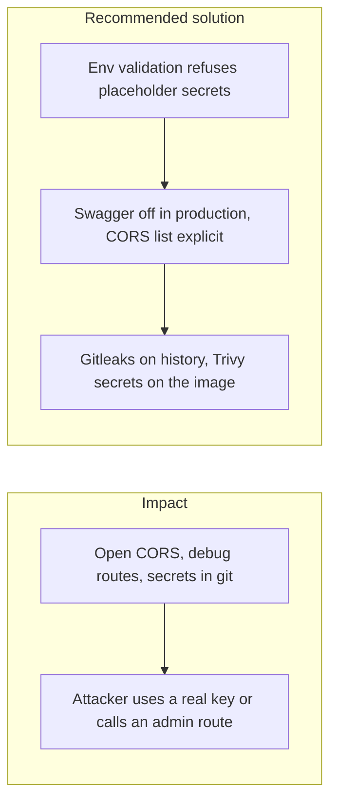
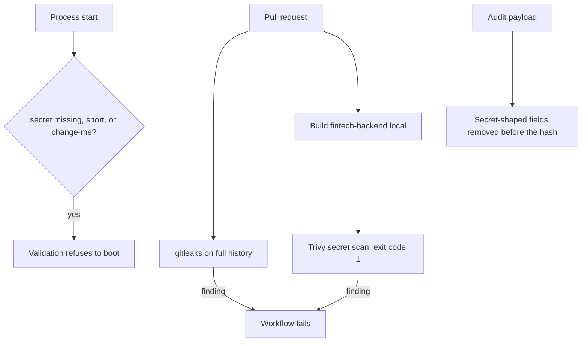

# 017. Security Misconfiguration and Leaked Secrets



## Problem

The defaults that make local development easy are the ones that leak in production: CORS `*`, Swagger left on, a `change-me` JWT secret, a public object bucket, verbose errors that include a stack and a SQL fragment, and API keys committed next to `.env.example`.

## Impact

- Anyone who can load the front end can call the API from their origin.
- A token signed with the sample secret is accepted.
- A database URL or webhook secret in git history is valid until someone rotates it.
- An error response teaches an attacker the query that failed.

## Recommended solution

`ConfigModule` validation requires secrets of at least 32 characters and rejects the placeholder `change-me`. It reports the variable name, never the value. `CORS_ORIGINS` is an explicit list. Swagger is served only when `NODE_ENV` is not production. Helmet stays on. `.env` and `dev.local` Postman environments stay gitignored. Scanners run on the repo and on images. The audit redaction step replaces secret-shaped fields with `[REDACTED]` before a payload is hashed.

## Code



`.github/workflows/security.yml` runs two jobs. Tags are the pins in `modular_monolith/.env.example`: `GITLEAKS_TAG` `v8.30.1` and `TRIVY_TAG` `0.75.0`. A finding fails that job, so the workflow fails. CBOM and image signing stay in the rest of A-C3.

`gitleaks` checks out the full history and runs `gitleaks detect` on it. `.gitleaks.toml` extends the default rules and allowlists three fixtures already in history: the webhook unit-test HMAC, the RFC 6238 TOTP test vector, and the removed Nest scaffold badge token. A later commit that adds a different high-entropy key fails this job. The key used to prove that stays on a branch that is not merged.

`image-secrets` builds `fintech-backend:local`. The Dockerfile runs `prisma generate --sql`, so the job starts Postgres, creates the `migrator`, `app_writer`, and `auditor_ro` roles, and applies migrations before the build. Trivy then scans that image with the secret scanner only. `--exit-code 1` fails the job when a secret is found. Vulnerability severity gates stay in A-C3.

```bash
docker run --rm -v "${GITHUB_WORKSPACE}:/repo" \
  "ghcr.io/gitleaks/gitleaks:${GITLEAKS_TAG}" \
  detect --source /repo --no-banner --redact --exit-code 1
```

```bash
docker build \
  --add-host=host.docker.internal:host-gateway \
  --build-arg MIGRATOR_DATABASE_URL=postgresql://migrator:ci@host.docker.internal:5432/fintech \
  -t fintech-backend:local \
  -f Dockerfile .
```

```bash
docker run --rm -v /var/run/docker.sock:/var/run/docker.sock \
  "aquasec/trivy:${TRIVY_TAG}" image \
  --scanners secret \
  --exit-code 1 \
  --disable-telemetry \
  --skip-version-check \
  fintech-backend:local
```
