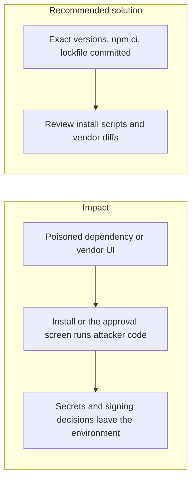
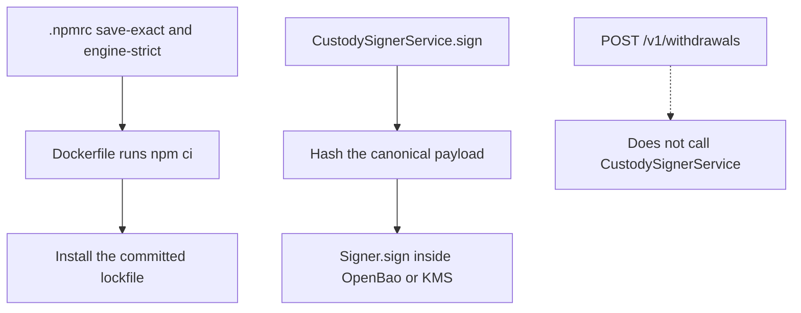

# 018. Software Supply-Chain Compromise



## Problem

The application trusts its build. A malicious release of a transitive package, a tampered CI plugin, or a changed vendor UI runs with the permissions of the developer or the production task. From January 2025 through September 2026 this class of attack accounted for the largest share of recorded crypto-platform losses, including a multisig UI that showed operators a different transaction from the one they signed.

## Impact

- CI secrets and cloud tokens are exfiltrated during `npm install`.
- A dependency that runs on the server reads environment variables and the OpenBao token.
- Operators approve a withdrawal whose displayed destination is not the signed one.
- A lockfile that is not committed lets production resolve a different tree than the one that was reviewed.

## Recommended solution

`.npmrc` sets `save-exact=true` and `engine-strict=true`. Install with `npm ci` from the committed lockfile. Pin Docker image tags. Treat `install` and `postinstall` scripts as a review item, and check license, age, and audit before adding a package. Custody signing uses the canonical payload the server built, inside OpenBao or the KMS, so a compromised process cannot export the key and a tampered screen cannot swap the bytes. When an approver screen exists, it shows that same payload.

## Code



`.npmrc` is those two lines. Both Docker stages copy the lockfile and run `npm ci`. `CustodySignerService.sign` hashes the canonical payload and calls `Signer.sign`. The private key stays in OpenBao or KMS. Nothing in the withdrawal payout calls `CustodySignerService` yet, so that audit row is not written on today's `POST /v1/withdrawals`.

```
save-exact=true
engine-strict=true
```

```dockerfile
COPY package.json package-lock.json .npmrc ./
RUN npm ci
```

```typescript
const canonical = canonicalize(request.payload);
const bytes = Buffer.from(canonical, 'utf8');
const payloadHash = createHash('sha256').update(bytes).digest('hex');
const signature = await this.signer.sign(bytes, this.keyRef);
```
