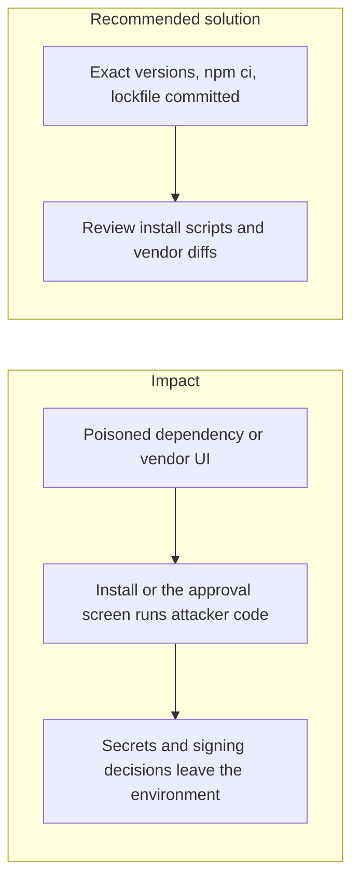

# 018. Software Supply-Chain Compromise

## Problem

The application trusts its build. A malicious release of a transitive package, a tampered CI plugin, or a changed vendor UI runs with the permissions of the developer or the production task. From January 2025 through September 2026 this class of attack accounted for the largest share of recorded crypto-platform losses, including a multisig UI that showed operators a different transaction from the one they signed.

## Impact

- CI secrets and cloud tokens are exfiltrated during `npm install`.
- A dependency that runs on the server reads environment variables and the OpenBao token.
- Operators approve a withdrawal whose displayed destination is not the signed one.
- A lockfile that is not committed lets production resolve a different tree than the one that was reviewed.

## Recommended solution

`.npmrc` sets `save-exact=true` and `engine-strict=true`. Install with `npm ci` from the committed lockfile. Pin Docker image tags. Treat `install` and `postinstall` scripts as a review item, and check license, age, and audit before adding a package. The approval UI for custody is ours: it renders the canonical payload. Vendor screens are not the thing an operator signs. Signing stays inside OpenBao or the KMS, so a compromised app process still cannot export the key.
