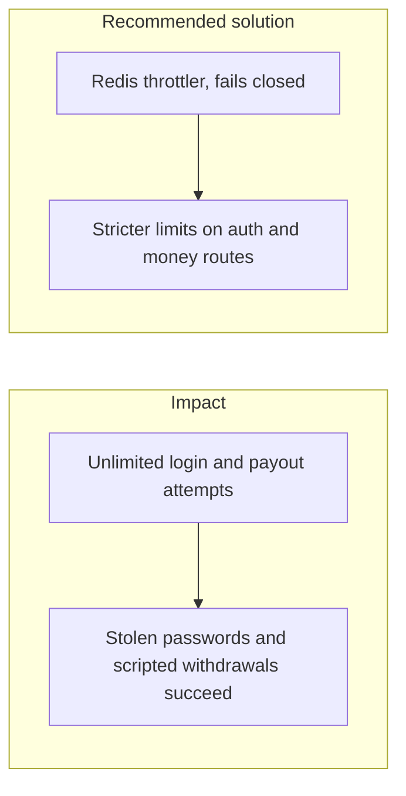
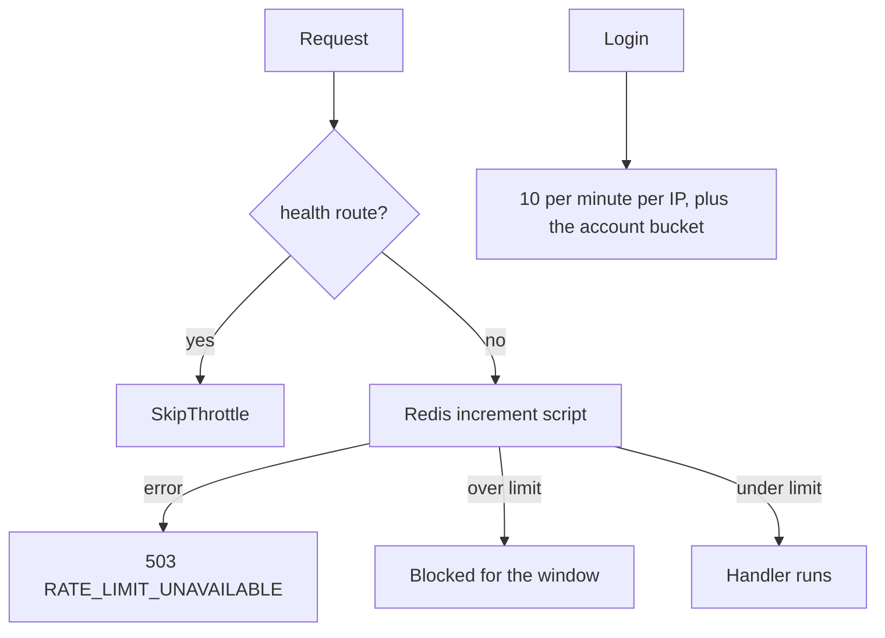

# 019. Bots, Credential Stuffing, and Rate Limits



## Problem

Login, password reset, quotes, and payouts are automated targets. Session design and TOTP do not slow a botnet that tries millions of passwords or that hammers a withdrawal route with a stolen token. A rate limiter that fails open when Redis is down removes the control at the moment of an incident.

## Impact

- Credential stuffing takes over accounts whose passwords were reused.
- A scripted client drains a balance in many small withdrawals under the human review threshold.
- One tenant generates enough traffic to slow transfers for everyone.
- Health checks get throttled and the orchestrator restarts a healthy app, or the opposite: money routes share the unlimited health budget.

## Recommended solution

`@nestjs/throttler` stores counters in Redis. The check-and-block runs in one script so the decision is atomic. A Redis error returns 503 `RATE_LIMIT_UNAVAILABLE` and does not serve the request unthrottled. Health is excluded. Auth and money routes use tighter limits than read routes. Keys are per IP and per account. `TRUST_PROXY` is set only to the real hop count so clients cannot spoof the address that the limit uses.

## Code



`RedisThrottlerStorage.increment` throws `RateLimitUnavailableException` when the Redis script throws. That exception is HTTP 503 and code `RATE_LIMIT_UNAVAILABLE`. `HealthController` is `@SkipThrottle()`. Login is 10 per minute per IP plus the account bucket. The default for other routes, including transfers and withdrawals, is 120 per minute. `setupApp` sets Express `trust proxy` only when `TRUST_PROXY` is greater than 0.

```typescript
} catch (err) {
  // Fail closed: without Redis no request is checked, so none is let through
  this.logger.error({ err }, 'Rate limit check failed');
  throw new RateLimitUnavailableException();
}
```

```typescript
export const RATE_LIMITS = {
  default: { limit: 120, ttl: minutes(1) },
  account: { limit: 10, ttl: minutes(15), blockDuration: minutes(15) },
  register: { limit: 10, ttl: minutes(60) },
  login: { limit: 10, ttl: minutes(1), blockDuration: minutes(5) },
  refresh: { limit: 30, ttl: minutes(1) },
  logout: { limit: 30, ttl: minutes(1) },
  totp: { limit: 5, ttl: minutes(1), blockDuration: minutes(5) },
  walletCreate: { limit: 10, ttl: minutes(1) },
} as const;
```

```typescript
@SkipThrottle()
@Public()
@Controller('health')
```
