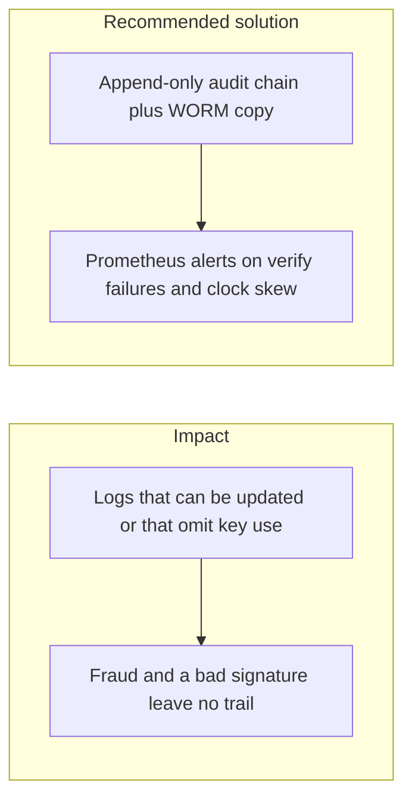

# 020. Security Logging and Alerting Failures



## Problem

A control that nobody hears fail is not a control. Missing logs of failed signature checks, key use, withdrawal-limit hits, and admin exports mean the first sign of fraud is a customer. A log that the app role can `UPDATE`, or that contains full PANs and secrets, fails the investigation and the privacy review at once.

## Impact

- A revoked key keeps being presented and nobody is paged.
- An investigator cannot show which withdrawal was approved by whom.
- Secrets written into the log become permanent once the log is hashed.
- A superuser edit of the audit table hides the original event.

## Recommended solution

Business actions write an outbox row in the same transaction, and a worker appends hash-chained audit events. The app role has `SELECT` and `INSERT` on audit, not `UPDATE` or `DELETE`. Signed tree heads are copied to S3 Object Lock. Redaction drops secret and PII fields before the payload is hashed. Pino carries a request id. Prometheus alerts already cover audit failures and clock offset. Page a human on verify failures, withdrawal limit breaches, and refresh-token reuse.

## Code

`MetricsService` counts three signals. `SignerService.verify` increments `fintech_signature_verify_failures_total` on every false return, and a key-store error still throws without a count. `TransfersService` increments `fintech_withdrawal_limit_breaches_total` where it throws the daily-limit rejection. `WithdrawalPolicyService.evaluate` increments the same counter when `evaluateWithdrawalPolicy` rejects for `OVER_DAILY_LIMIT`. `AuthService.refresh` increments `fintech_refresh_reuse_total` next to the existing warn when the outcome is `reused`.

`docker/prometheus/alerts/security.yml` is loaded with `audit.yml` and `clock.yml` by the `alerts/*.yml` rule file. Verify failures and limit breaches are warning. Refresh reuse is critical. Each rule is `increase(...[15m]) > 0`.

```typescript
recordSignatureVerifyFailure(): void {
  this.signatureVerifyFailures.inc();
}

recordWithdrawalLimitBreach(): void {
  this.withdrawalLimitBreaches.inc();
}

recordRefreshReuse(): void {
  this.refreshReuse.inc();
}
```

```typescript
const accepted = await this.signatureMatches(bytes, signature, anchor);
if (!accepted) this.metrics?.recordSignatureVerifyFailure();
return accepted;
```

```yaml
- alert: SignatureVerifyFailures
  expr: increase(fintech_signature_verify_failures_total[15m]) > 0
  labels:
    severity: warning
- alert: WithdrawalLimitBreaches
  expr: increase(fintech_withdrawal_limit_breaches_total[15m]) > 0
  labels:
    severity: warning
- alert: RefreshTokenReuse
  expr: increase(fintech_refresh_reuse_total[15m]) > 0
  labels:
    severity: critical
```
