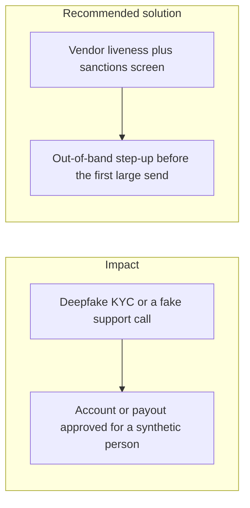

# 021. AI-Assisted Fraud and Synthetic Identity

## Problem

Phishing and account opening now use generated faces, documents, and voice. Chainalysis's 2026 scam figures show operations linked on-chain to AI vendors taking about 4.5 times more per scam than operations without that link. The target is the KYC reviewer and the support queue, not only the password form.

## Impact

- A synthetic identity passes a document check and receives a limit.
- A support agent resets TOTP after a convincing call.
- A mule account stays under automated thresholds and cashes out through many small withdrawals.
- Chargebacks and sanctions exposure land on the platform after the funds have settled.

## Recommended solution

Gate money movement on a KYC vendor decision that includes liveness, and on sanctions screening, not on a document image alone. The first withdrawal above the limit requires TOTP step-up and the custody delay. MFA reset and limit changes are audited admin actions with four eyes. Train support to verify a callback to a number already on the account. Rate limits and device signals still apply. The model that scores risk is an input to a human or to a hard rule. It is not the only approver.
