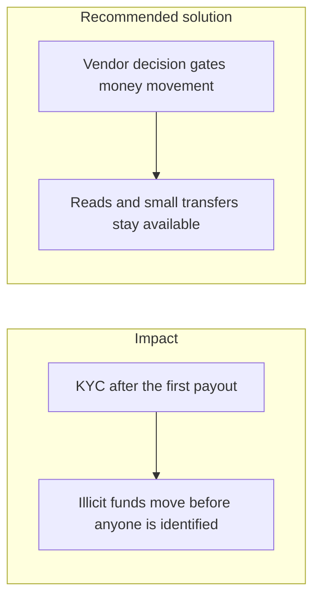

# 022. KYC and AML Integration

## Problem

Identity verification and transaction monitoring have to run in the product without turning every signup into a abandoned form. Checking KYC only after a withdrawal, or blocking the entire app until a manual review finishes, each fails a different obligation: one fails the law, the other fails conversion.

## Impact

- Mule accounts cash out before a document is reviewed.
- A user who cannot finish KYC on a phone never funds the wallet, so the business never starts.
- A vendor outage either halts all payments or, if the app fails open, skips the check.
- Audit cannot show which decision allowed a given transfer.

## Recommended solution

Let registration and read-only views complete. Gate the first money movement, and any movement above a threshold, on a recorded KYC and AML vendor decision. Store the decision reference and the time, not a copy of the identity document in the ledger. If the vendor is unavailable, fail closed for new payouts and keep already-authorized reads up. Record the decision on the append-only audit log. Step-up TOTP still applies on top of a passed KYC check. KYC is not a substitute for authorization or for sanctions screening.
