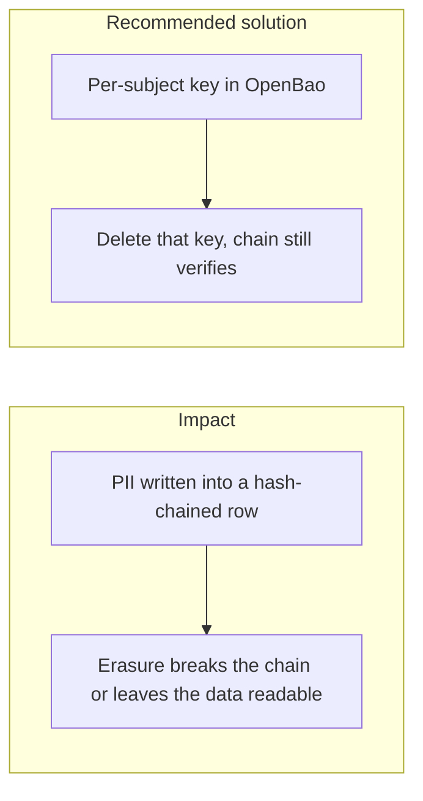
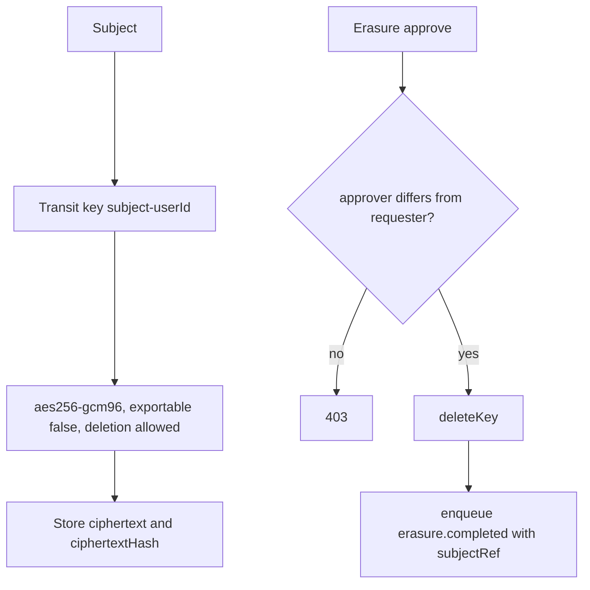

# 023. Data Privacy versus Immutability



## Problem

GDPR's right to erasure asks the operator to stop being able to read a person's data. A hash-chained audit log and a financial ledger must stay verifiable and must keep the books. Deleting the row breaks the chain. Leaving the name and document number in the hashed payload means erasure never happened.

## Impact

- A privacy request cannot be completed, or completing it makes every later proof fail.
- Backups restore the plaintext the operator claimed to delete.
- Financial records needed for tax and disputes disappear with the profile.
- A label or an email inside a hashed payload identifies the subject forever.

## Recommended solution

This platform's privacy control is crypto-shredding. Each subject has a Transit key (`deletion_allowed` set). The database and backups hold ciphertext only. Audit payloads store `subjectRef` and a hash of the ciphertext, not plaintext PII. `POST /v1/privacy/erasure/:userId` is a compliance-role, four-eyes action: it deletes the subject key and records `erasure.completed`. The hash chain still verifies. Ledger amounts and account ids stay readable because they are the financial record, not the identity document. Wallet labels are user-written text and are redacted before they enter a hashed payload.

## Code



`SubjectKeysService.ensureKey` creates `subject-<userId>` as `aes256-gcm96` with `deletion_allowed: true` and `exportable: false`. `ErasureService.approve` refuses the requester as approver, calls `deleteKey`, then enqueues `erasure.completed` with `subjectRef` and no plaintext. `PrivacyService.storeField` writes ciphertext and `ciphertextHash` only.

```typescript
await this.request('POST', `transit/keys/${encodeURIComponent(name)}`, {
  type: 'aes256-gcm96',
  deletion_allowed: true,
  exportable: false,
});
```

```typescript
if (row.requesterId === approverId)
  throw new ForbiddenException('four-eyes: approver must differ from requester');

await this.keys.deleteKey(row.subjectRef);
```

```typescript
await this.outbox.enqueue(tx, 'auth', {
  type: 'erasure.completed',
  schemaVersion: 1,
  occurredAt: new Date().toISOString(),
  actor: { subjectRef: approverId },
  ...(requestIdHdr !== undefined ? { requestId: requestIdHdr } : {}),
  subjectRef: row.subjectRef,
  requesterId: row.requesterId,
  approverId,
});
```
