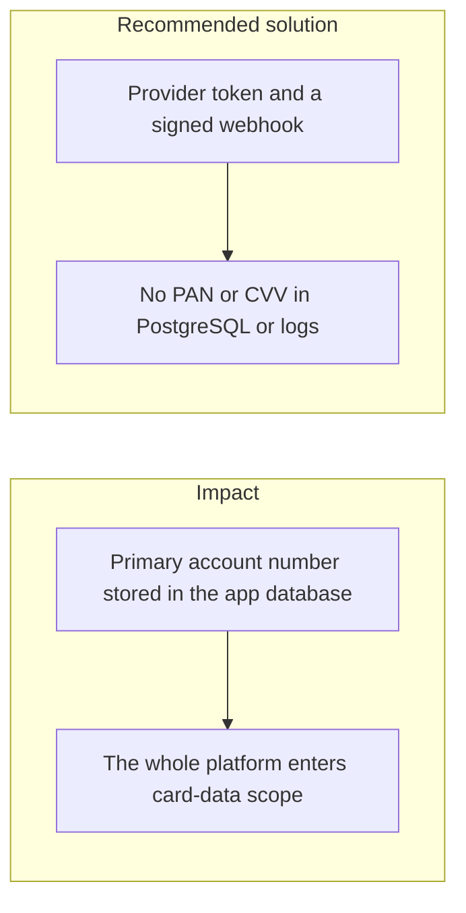
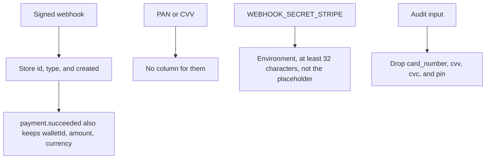

# 024. PCI-DSS Compliance



## Problem

If the app sees a primary account number, PCI-DSS scope covers the systems that store, process, or transmit it. Logging the number, putting it in an audit hash, or keeping it "just for refunds" is enough to enter that scope. A webhook that says a card payment succeeded is not itself a license to store the card.

## Impact

- A database backup is a cardholder-data breach.
- Audit retention keeps the number for years.
- The assessment cost and the control set jump from a tokenized integration to the full card environment.
- A CVV stored beside the number fails the standard outright.

## Recommended solution

Take card payments through a provider (this platform verifies signed webhooks, starting with the Stripe secret). Persist the provider's charge id and a token, never the PAN or CVV. Redaction already strips secret-shaped fields before an audit payload is hashed. Keep `WEBHOOK_SECRET_STRIPE` in the environment while there is one provider secret, so database backups do not copy it. A sealed database row is the place for provider secrets once several of them must rotate without a process restart. If a future feature must touch raw card data, isolate that process, its database, and its keys from the ledger app.

## Code



`payments.webhook_events.payload` keeps `id`, `type`, `created`, and for `payment.succeeded` only `walletId`, `amount`, and `currency`. There is no PAN column. `WEBHOOK_SECRET_STRIPE` is required in the environment, at least 32 characters, and must not be the placeholder. Audit redaction drops keys named `card_number`, `cvv`, `cvc`, or `pin` before the payload is hashed.

```typescript
export const STORED_EVENT_FIELDS = ['id', 'type', 'created'] as const;

/** `data` fields kept per event type; a type without an entry keeps no `data` at all. */
export const STORED_DATA_FIELDS: Readonly<Record<string, readonly string[]>> = {
  [PAYMENT_SUCCEEDED]: ['walletId', 'amount', 'currency'],
};
```

```typescript
@IsString()
@MinLength(32)
@NotEquals(PLACEHOLDER)
WEBHOOK_SECRET_STRIPE: string;
```

```typescript
const SECRET_KEY =
  /^(authorization|cookie|set-cookie|password|passwd|secret|token|api[_-]?key|private[_-]?key|refresh[_-]?token|access[_-]?token|client[_-]?secret|card[_-]?number|cvv|cvc|pin)$/i;
```
