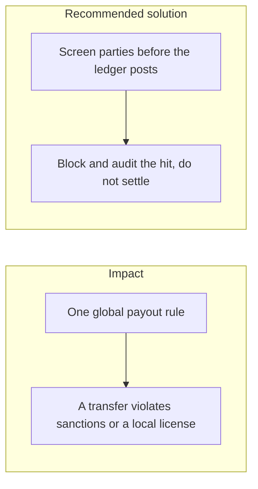
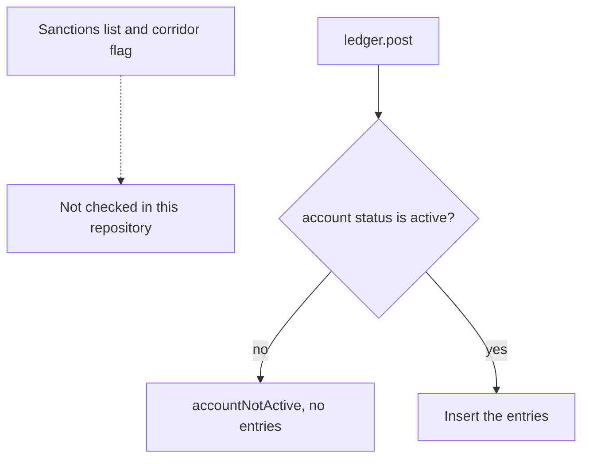

# 025. Cross-Border Legal Restrictions



## Problem

Money transmission, crypto-asset classification, and sanctions lists are not the same in every country the user can select. OFAC and FATF obligations attach to the operator even when the user is elsewhere. A single "send anywhere" button encodes a legal decision the code does not know it made.

## Impact

- A payment to a listed party settles and the reversal is incomplete.
- The firm offers exchange or custody in a jurisdiction where it has no license.
- A user blocked in one region opens an account with another country code and the same identity.
- There is no record of the list version that was checked, so a later review cannot show the decision was reasonable.

## Recommended solution

Before a cross-border or crypto payout posts, screen the parties against the sanctions lists the license requires, and store the list version and the result on the audit log. Refuse the posting when the screen hits. Do not credit or debit first and screen second. Restrict corridors in configuration, not in a comment. Pair this with the Travel Rule data on crypto transfers described in [027. Travel Rule, MiCA, and crypto-asset conduct](027_travel_rule_mica_and_crypto_asset_conduct.md). Licensing limits are a product gate: the API rejects a corridor that is not enabled.

## Code



No sanctions list, list version, or corridor flag is checked before `ledger.post`. The gate that does run is account status: a frozen or closed account throws `accountNotActive` and no entry is inserted.

```typescript
if (account.status !== AccountStatus.active)
  throw accountNotActive(account.id, account.status);
```
