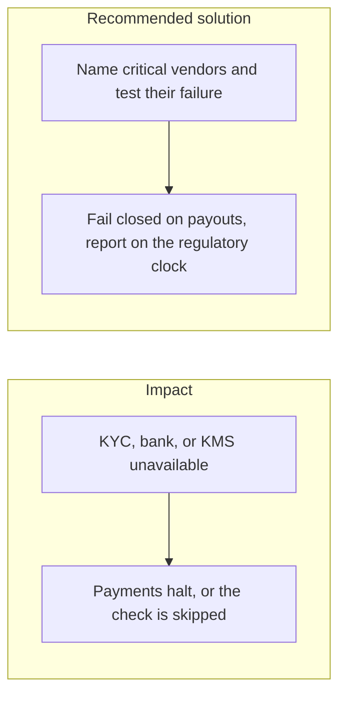

# 026. Operational Resilience and Third-Party ICT Risk

## Problem

The EU Digital Operational Resilience Act, applicable from January 2025, treats the KYC vendor, the bank, the HSM, and the cloud KMS as part of the firm's operations. "The API timed out" is an incident when that API is on the payment path. A design that only works when every vendor is healthy will either stop all business or silently skip a control.

## Impact

- A KMS outage stops signing, and a homemade fallback key is introduced during the incident.
- A KYC outage fails open and unscreened payouts go out.
- The firm cannot tell a regulator which vendor failed, or how long the workaround ran.
- A restore test has never been run, so the backup does not actually restore.

## Recommended solution

Keep a list of critical ICT providers (identity, payments, OpenBao or KMS, TSA, object storage) and an owner for each. Payouts fail closed when the signer or the sanctions screen is down. Reads can degrade. Timeouts are explicit. The stage-2 gateway's circuit breaker (`opossum`) stops calling a dead vendor. Run the database backup-and-restore drill on a schedule. Write the incident down, including start time, so the regulatory notification clock has a real start. Do not stand up an exportable signing key as a workaround.
