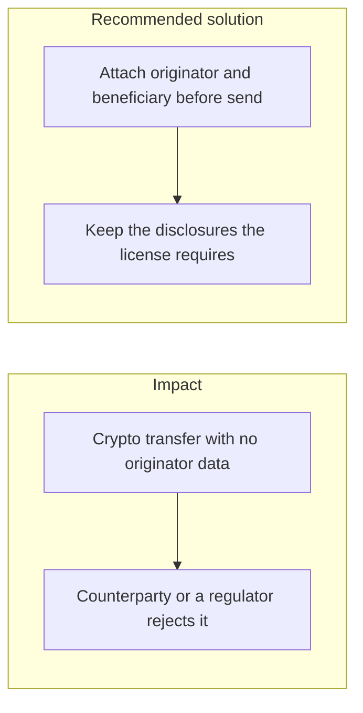
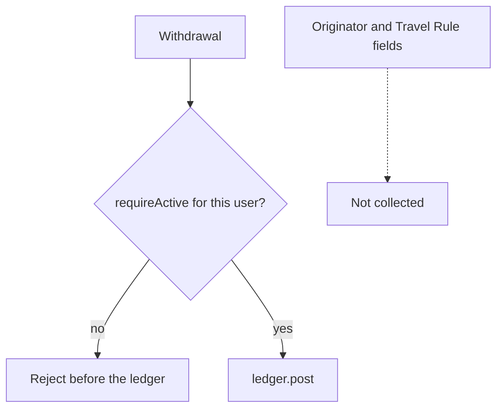

# 027. Travel Rule, MiCA, and Crypto-Asset Conduct



## Problem

A crypto transfer above the local threshold has to carry originator and beneficiary information to the receiving institution (the Travel Rule). In the EU, the Markets in Crypto-Assets regulation adds conduct, disclosure, and stablecoin obligations on top of sanctions screening. A withdrawal that is only an address and an amount does not meet either duty.

## Impact

- The receiving exchange returns the funds or freezes them, and the user sees a debit with no credit.
- The firm cannot show who sent a transfer when a supervisor asks.
- A stablecoin balance is offered without the reserve and disclosure duties that apply to it.
- Sanctions screening of the name never happens because the name was never collected.

## Recommended solution

Collect and validate originator and beneficiary fields before a qualifying crypto withdrawal is signed. Send them to the counterparty through the channel the license names, and store a reference on the audit log, with PII encrypted under the subject key from [023. Data privacy versus immutability](023_data_privacy_vs_immutability.md). Screen those names under [025. Cross-border legal restrictions](025_cross_border_legal_restrictions.md). Do not sign the on-chain transaction until that record exists. Publish the disclosures the license requires in the product. Do not add them only in a PDF nobody's flow reads.

## Code



Originator name, beneficiary name, and a Travel Rule reference are not fields on the withdrawal. The payout still refuses a destination that is not an active allow-listed `Beneficiary` for that user. That row stores label, currency, address, and network. It does not store the originator.

```typescript
const beneficiary = await this.beneficiaries.requireActive(
  userId,
  dto.beneficiaryId,
);
```
