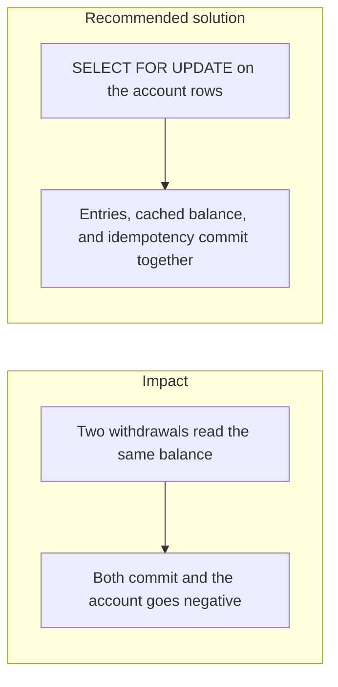

# 028. Race Conditions and Double-Spending

## Problem

Two requests can each read a balance of 500, each decide that a withdrawal of 500 fits, and each commit. The account is then negative, or the same funds have been promised twice. Checking the balance in the application and updating it in a later statement is the usual shape of this bug. A unique id on the request does not fix it if the balance write is outside the lock.

## Impact

- The platform pays out money it does not hold.
- A retry and an original request both succeed. See also [030. Idempotency of money movement](030_idempotency_of_money_movement.md).
- The cached balance drifts from the sum of ledger entries.
- Support reverses one of the two payments by editing a row, which breaks the append-only ledger.

## Recommended solution

Ledger entries are the source of truth. A balance is not changed with a bare `UPDATE balance = balance + x`. The cached balance moves only inside the same transaction that inserts the matching debit and credit, after `SELECT ... FOR UPDATE` on the account rows. Isolation is Read Committed plus those locks, or Serializable with a retry on serialization failure. The proof already required by the build plan: 100 parallel withdrawals of 10 from a balance of 500 end with exactly 50 successes and a balance that is never negative.
