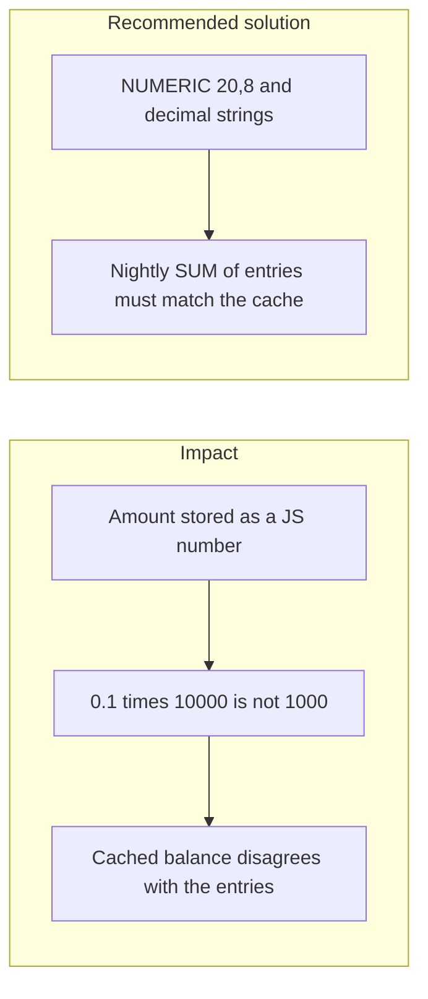
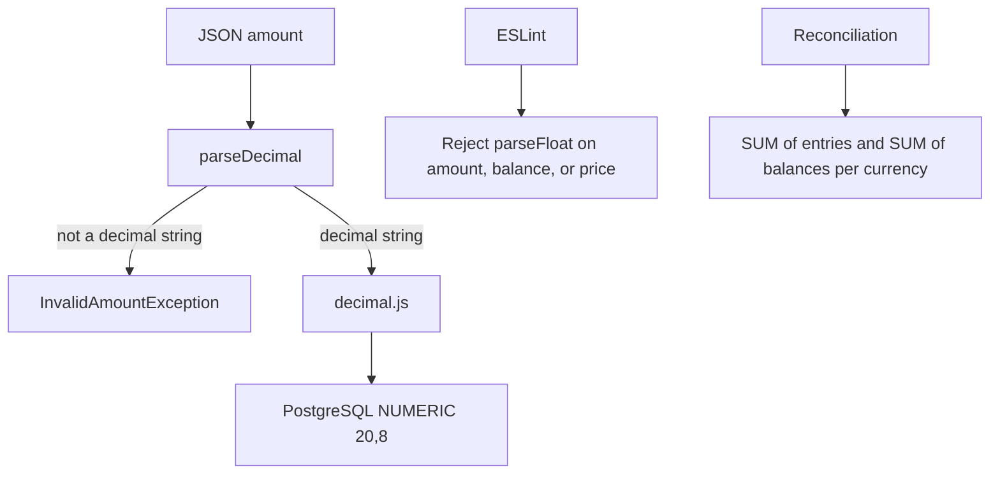

# 029. Money Representation and Ledger Invariants



## Problem

Binary floating point cannot represent most decimal amounts. `0.1` added enough times is not the decimal the user expects. A cached balance updated on its own, a posting in two currencies, or a posting whose entries do not sum to zero, loses money with no attacker and no race.

## Impact

- Users are credited or debited a fraction that the product cannot explain.
- A report totals a different number from the rows it lists.
- A later reconciliation "fix" edits history.
- JSON numbers get parsed with `parseFloat` at the boundary and the exact decimal is already gone.

## Recommended solution

PostgreSQL stores money as `NUMERIC(20, 8)`. JSON uses decimal strings such as `"1500.00"`. Application code uses `decimal.js` and never converts a money value to a JS `number`. ESLint rejects `parseFloat`, `parseInt`, `Number`, and unary plus on names that look like amount, balance, or price. Each posting has at least two entries, one currency, summing to zero. The cached balance is updated only in the posting transaction. A nightly reconciliation job checks every cached balance against `SUM(entries)` and checks that per-currency totals are zero. Corrections are new reversing entries, not updates.

## Code



`Account.balance` and `LedgerEntry.amount` are `Decimal(20, 8)`. `parseDecimal` accepts a decimal string or a `Decimal` and throws `InvalidAmountException` for anything else. ESLint's `no-restricted-syntax` rule flags `parseFloat`, `parseInt`, `Number`, and unary `+` on names matching `amount`, `balance`, or `price`. `getCurrencyTotals` sums cached balances and entry amounts per currency. `parsePosting` rejects a non-zero sum before the database is touched.

```typescript
export function parseDecimal(value: string | Decimal): Decimal {
  if (value instanceof Decimal) return value;
  if (typeof value !== 'string' || !DECIMAL_STRING.test(value)) {
    throw new InvalidAmountException(
      'Amount must be a decimal string such as "1500.00".',
    );
  }
  return new Decimal(value);
}
```

```javascript
const MONEY = '/amount|balance|price/i';
```

```sql
SELECT currency, SUM(amount) AS entries
FROM ledger.ledger_entries
GROUP BY currency
```
