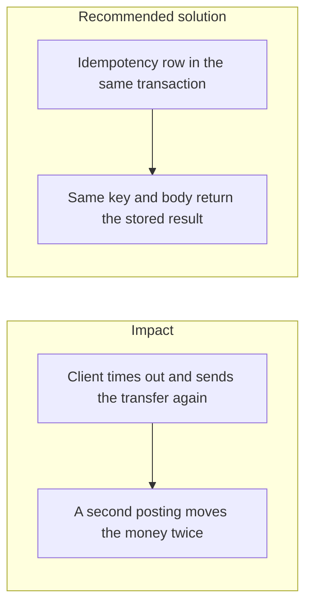

# 030. Idempotency of Money Movement

## Problem

Payment clients retry. A timeout does not mean the server failed to commit. If the second call creates another transfer, the user pays twice. An idempotency key stored after the money movement, or in a different database, still allows both calls to pass the check. A key that is not bound to the body lets a caller reuse a successful key for a different amount.

## Impact

- Duplicate card captures, payouts, or internal transfers.
- A crash between the balance update and the idempotency insert pays once and then pays again on retry.
- Two users who pick the same key collide, or one user replays another user's key.
- The client receives a 500 and retries into a second success, so support sees two ids for one intent.

## Recommended solution

Every money-moving path calls `IdempotencyService.runOnce` with a scope and a key. Transfers use the scope `transfer:<userId>`, so keys are per caller. The row has `UNIQUE (scope, key)` and is written in the same transaction as the ledger entries and the outbox row. The same key with the same body returns the stored result until the window expires, including when many retries arrive in parallel. The same key with a different body is rejected. The build plan's proof is a webhook delivered 10 times sequentially and 20 times in parallel producing one payout, including when the process crashes before commit.
