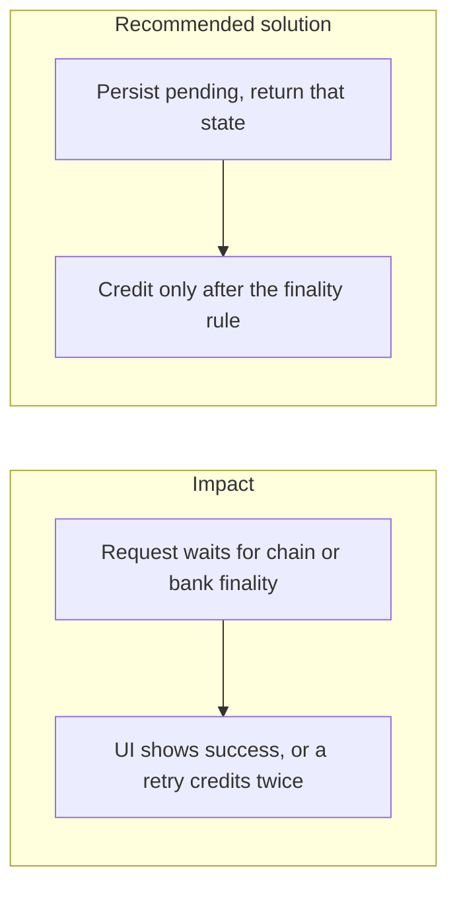

# 031. Network Latency and Transaction Finality

## Problem

Blockchain confirmations and bank settlement take longer than an HTTP request should block. If the handler waits, the client times out and retries. If the handler tells the user "done" when the transaction is only broadcast, a reorg or a returned payment has already been spent in the UI. The in-memory spinner is not a record of the state.

## Impact

- Users refresh and submit a second withdrawal.
- A deposit is credited on broadcast and the chain later drops it.
- The ledger and the external network disagree, and there is no row that says "pending".
- Support cannot tell a slow payment from a lost one.

## Recommended solution

Write the intent in the database first, with an explicit status (`pending`, `confirmed`, `failed`), and return that status. A worker watches confirmations or bank callbacks off the request path. Credit or release the hold only when the product's finality rule is met (enough confirmations, or a settled bank status), and do it through the idempotent ledger path. The client renders the stored status. It does not invent a success from a spinner that finished. Timeouts on the provider call are bounded so one slow bank does not hold a database transaction open.
