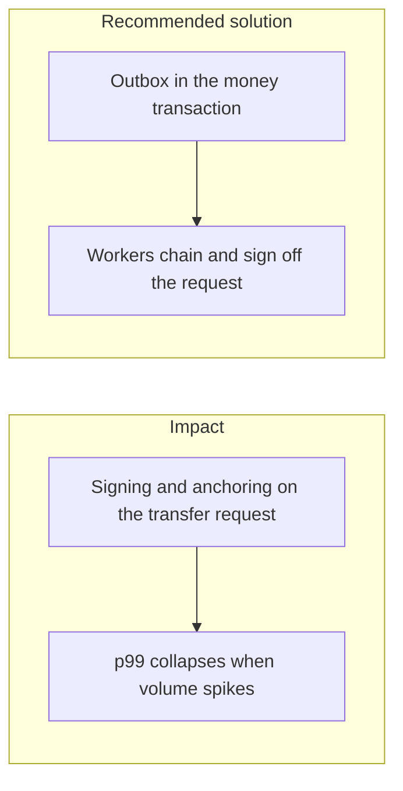

# 032. Scalability under Market Volatility

## Problem

A volatility spike is when the ledger is busiest and when users retry the most. Doing Merkle trees, HSM signatures, and object-storage writes inside `POST /v1/transfers` makes that spike also an audit spike. A single hash chain that every event appends to becomes a global lock.

## Impact

- Transfers time out, clients retry, and idempotency is the only thing preventing duplicate posts.
- The HSM queue backs up and withdrawals stall behind audit signatures.
- One busy partition blocks unrelated currencies.
- Operators scale the database when the bottleneck is the synchronous signature.

## Recommended solution

The money transaction writes the business rows and an outbox row, then returns. Workers chain audit events per partition, and only checkpoints are signed. Throughput can grow with partitions. The build plan's check is that p99 of `POST /v1/transfers` with audit enabled stays inside budget versus audit disabled, and that an audit backlog does not block requests. Rate limits keep a single client from consuming the pool. Add capacity for the ledger and the workers before adding a second write path.
