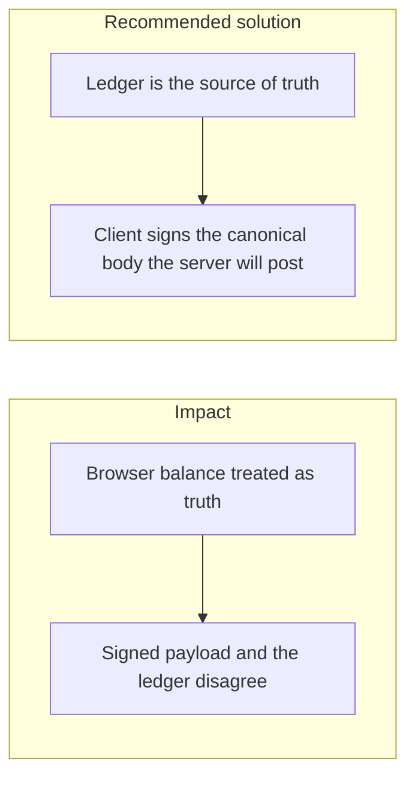

# 033. Client-Server State Synchronization

## Problem

The browser holds a cached balance, a drafted transfer, and sometimes a signature over that draft. The server holds the ledger. If those diverge, the user confirms one amount and the server posts another, or the client shows success for a request the server rejected. Optimistic UI that never reconciles makes the lie last.

## Impact

- A user signs a payload built from a stale balance and the transfer fails, or worse, the server accepts a body the user did not see.
- Two tabs submit two versions of the same payment.
- A reload shows a different balance from the one just displayed, and the user submits again.
- Support cannot reconstruct which bytes were signed.

## Recommended solution

The ledger is the source of truth. Clients refetch after every money call and render the envelope's data, not a locally incremented number. When the client signs, it signs the RFC 8785 form of the same body the server will verify and post. The server rejects a mismatch. Idempotency keys tie a retry to that body. Wallet renames and other non-money edits are scoped to the owner and return 404 for a stale id the caller does not own, so a client cannot "fix" state by writing someone else's row.
