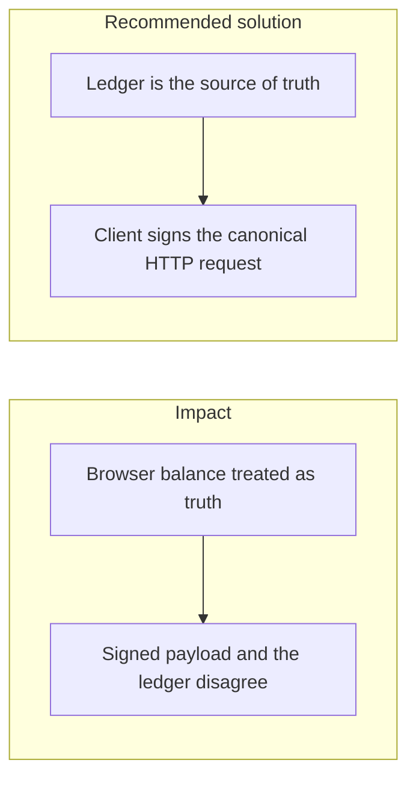
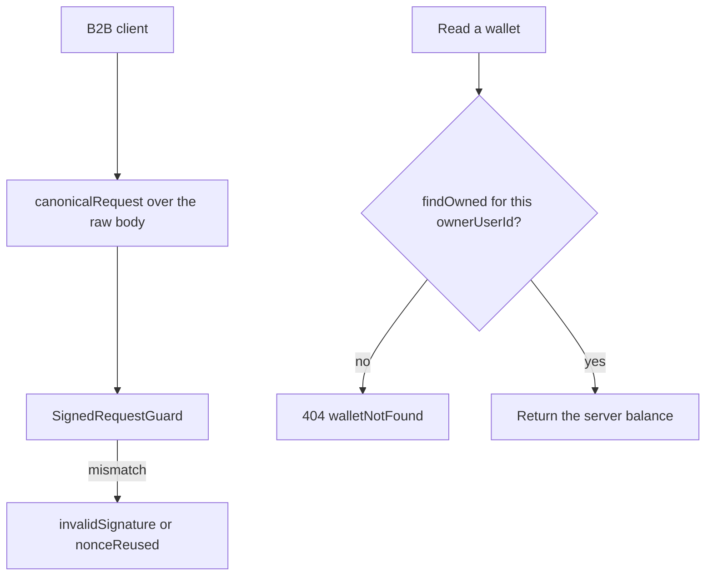

# 033. Client-Server State Synchronization



## Problem

The browser holds a cached balance, a drafted transfer, and sometimes a signature over that draft. The server holds the ledger. If those diverge, the user confirms one amount and the server posts another, or the client shows success for a request the server rejected. Optimistic UI that never reconciles makes the lie last.

## Impact

- A user signs a payload built from a stale balance and the transfer fails, or worse, the server accepts a body the user did not see.
- Two tabs submit two versions of the same payment.
- A reload shows a different balance from the one just displayed, and the user submits again.
- Support cannot reconstruct which bytes were signed.

## Recommended solution

The ledger is the source of truth. Clients refetch after every money call and render the server's data, not a locally incremented number. A B2B client signs the canonical HTTP request from [005. Signature and nonce mismatches](005_signature_and_nonce_mismatches.md): method, path, timestamp, nonce, and the raw-body hash. The server rejects a mismatch. Stored audit payloads use RFC 8785. Idempotency keys tie a retry to that body. Wallet renames and other non-money edits are scoped to the owner and return 404 for an id the caller does not own.

## Code



There is no browser balance in this repository. `canonicalRequest` is the bytes a B2B client signs, and `SignedRequestGuard` verifies that string. `WalletsService.findOwned` loads a wallet only when `ownerUserId` matches. `getOwned` throws `walletNotFound` (404) for a missing id and for another user's id.

```typescript
export function canonicalRequest(parts: CanonicalRequestParts): string {
  return [
    parts.method.toUpperCase(),
    parts.path,
    parts.timestamp,
    parts.nonce,
    sha256Hex(parts.body),
  ].join('\n');
}
```

```typescript
async findOwned(
  id: string,
  ownerUserId: string,
  tx: Prisma.TransactionClient = this.prisma,
): Promise<WalletView | null> {
  const wallet = await tx.wallet.findFirst({
    where: { id, ownerUserId },
  });
  return wallet && toView(wallet);
}
```
