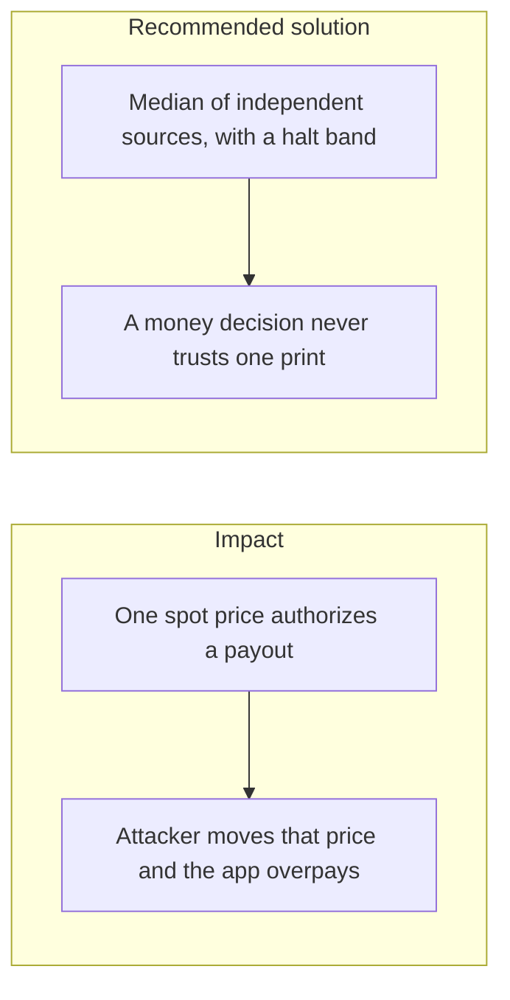

# 034. Price and Oracle Manipulation

## Problem

If a withdrawal, a collateral check, or a liquidation uses a price, that price is part of the money path. A single exchange print, a lagging internal number, or a pool an attacker can trade against will authorize a payout at a value the books cannot support. Centralized and decentralized platforms both lost funds this way in 2025–2026.

## Impact

- The ledger posts a correct amount in the wrong unit of value.
- A stale price lets a user withdraw more than the position is worth a moment later.
- Proof-of-reserves figures mix quantities with a manipulated valuation and look fully backed.
- There is no record of which price was used, so the posting cannot be explained.

## Recommended solution

This platform's ledger posts amounts in a stated currency. It does not mark a user balance to a live spot price inside the posting transaction. When a later feature needs a price to authorize money, take a median of independent sources, reject a source that jumps beyond a configured band, and halt the decision if too few sources answer. Store the sources and the value on the audit log. Proof of reserves stays a Merkle sum of quantities that a client can verify without learning other users' balances. It is not a single venue's last trade.
