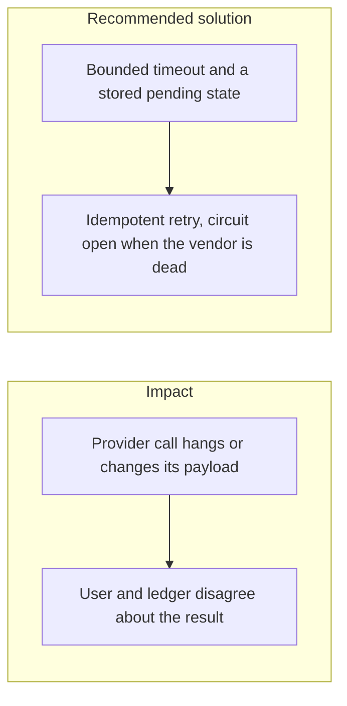
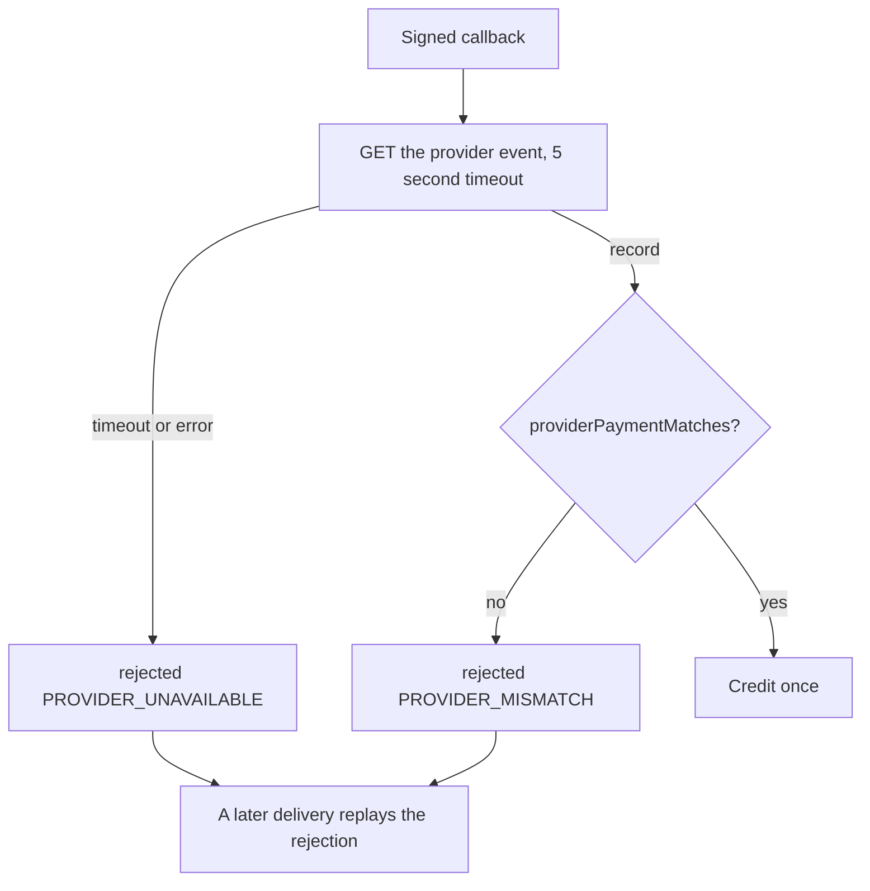

# 035. Wallet and Third-Party Integration Flakes



## Problem

Bank APIs, KYC vendors, and Web3 wallets drop connections, change fields, and return errors the client did not map. Wallet-connection flakes (MetaMask, WalletConnect) apply only when the product uses those wallets. Bank, card, and KYC failures apply to almost every fintech web app. Treating a timeout as "it failed" and also as "it succeeded" is how duplicate payouts start.

## Impact

- A user submits the payment again because the spinner never ended.
- A changed provider field is ignored and a deposit is never credited.
- One dead vendor occupies all outbound connections.
- The ledger has no row, so support cannot replay or refund from a record.

## Recommended solution

Persist the intent as `pending` before the outbound call. Bound the timeout. Map unknown responses to `pending`, not to success, and reconcile from the provider's own record. Retries use the idempotency key from [030. Idempotency of money movement](030_idempotency_of_money_movement.md). When the vendor stays down, open the circuit (the stage-2 gateway uses `opossum`) and fail closed for new payouts. Web3 wallet sessions, if added, are a client concern: the server still accepts only a verified signature over the canonical body.

## Code



There is no `pending` payment status and no `opossum` circuit breaker. `StripeEventClient.load` aborts after 5 seconds. `ProviderEventUnavailable` is stored as `rejected` with `PROVIDER_UNAVAILABLE` and does not post. A body that does not match the provider record is `PROVIDER_MISMATCH` and does not post. A later delivery of that event id replays the rejection. The idempotency key is the provider event id.

```typescript
res = await this.fetchFn(url, {
  method: 'GET',
  headers: { Authorization: `Bearer ${this.secret}` },
  signal: AbortSignal.timeout(TIMEOUT_MS),
});
```

```typescript
} catch (e) {
  if (!(e instanceof ProviderEventUnavailable)) throw e;
  return receiptOf(delivery, 'rejected', {
    code: 'PROVIDER_UNAVAILABLE',
    message: 'The provider event could not be loaded.',
  });
}
```
