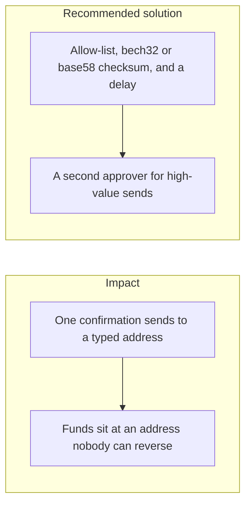

# 036. Irreversible User Errors



## Problem

A wrong address, a wrong network, or a lost seed phrase cannot be undone by the ledger. Safety checks have to catch the mistake before the signature, without collecting the seed into the web app. A confirmation dialog that restates the user's unchecked string does not catch a transposition.

## Impact

- A withdrawal to a mistyped address is final on the external network.
- A seed phrase typed into a support form is the key.
- A user approves the amount and misses that the asset or the chain changed.
- The platform reimburses from its own funds because the product made the mistake easy.

## Recommended solution

Custody withdrawals require an allow-listed destination, show the canonical address and decimal amount that will be signed, and wait out a delay before the `Signer` runs. High-value sends need a second approver. The server rejects an address that fails a bech32 or base58 checksum, and it rejects an address that is not on the list. Seed phrases and private keys are never accepted by an API field. Recovery is a new key ceremony in the HSM, not a form on the website. Internal ledger transfers stay reversible by a new reversing entry. External sends do not.

## Code

`BeneficiariesService.create` trims the address and rejects it with `INVALID_ADDRESS` (422) before insert. `bank_*` networks keep the 1–256 length check. Any other network must be bech32, bech32m, or base58check. A string that is neither encoding is rejected. The checksum uses `node:crypto` only (`address-checksum.ts`).

```typescript
const address = dto.address.trim();
const network = dto.network.trim().toLowerCase();
if (!addressChecksumOk(network, address)) throw invalidAddress();
```

```typescript
export function addressChecksumOk(network: string, address: string): boolean {
  const rail = network.trim().toLowerCase();
  const value = address.trim();
  if (rail.startsWith('bank_')) return value.length >= 1 && value.length <= 256;
  if (isBech32Shape(value)) return verifyBech32(value);
  if (isBase58Shape(value)) return verifyBase58Check(value);
  return false;
}
```

`verifyBech32` accepts BIP-173 (`polymod === 1`) and BIP-350 bech32m (`polymod === 0x2bc830a3`), so a taproot `bc1p…` address passes and a transposed `bc1…` does not. `verifyBase58Check` compares the trailing four bytes with `SHA256(SHA256(payload))` using `timingSafeEqual`. A bad check byte returns false and the row is not stored.
