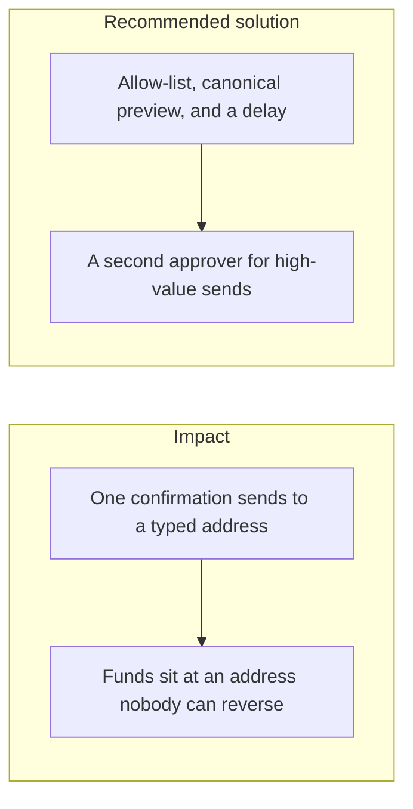

# 036. Irreversible User Errors

## Problem

A wrong address, a wrong network, or a lost seed phrase cannot be undone by the ledger. Safety checks have to catch the mistake before the signature, without collecting the seed into the web app. A confirmation dialog that restates the user's unchecked string does not catch a transposition.

## Impact

- A withdrawal to a mistyped address is final on the external network.
- A seed phrase typed into a support form is the key.
- A user approves the amount and misses that the asset or the chain changed.
- The platform reimburses from its own funds because the product made the mistake easy.

## Recommended solution

Custody withdrawals require an allow-listed destination, show the canonical address and decimal amount that will be signed, and wait out a delay before the `Signer` runs. High-value sends need a second approver. The server rejects an address that fails checksum or that is not on the list. Seed phrases and private keys are never accepted by an API field. Recovery is a new key ceremony in the HSM, not a form on the website. Internal ledger transfers stay reversible by a new reversing entry. External sends do not.
