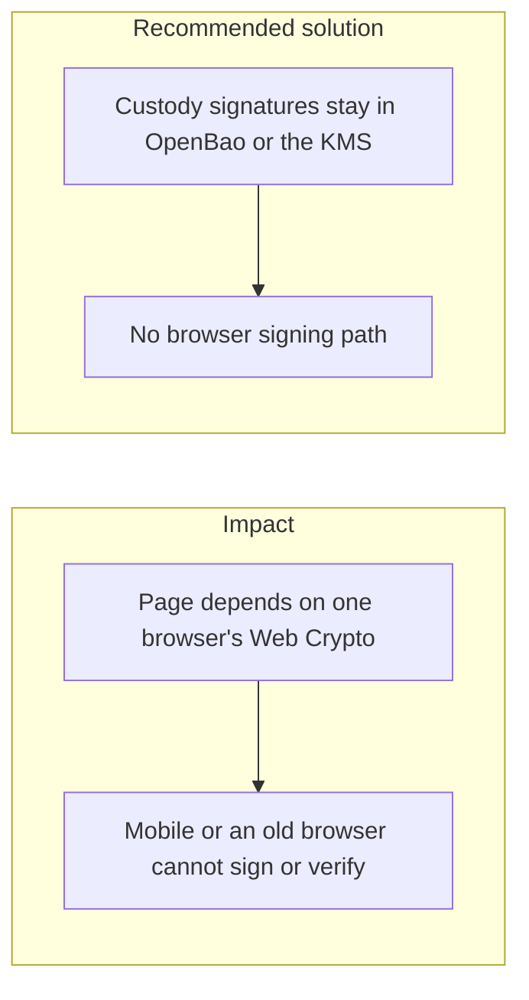
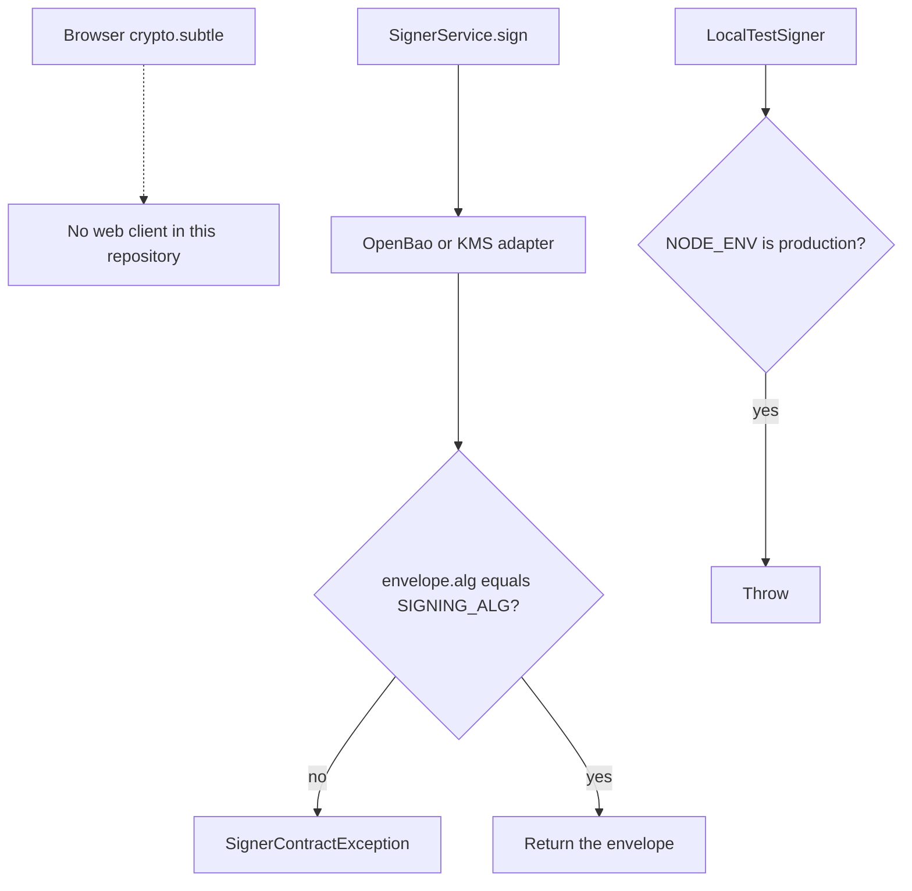

# 037. Cross-Browser and Cross-Device Compatibility



## Problem

`Web Crypto` is not the same on every mobile browser, desktop, and operating system. Secure-context rules, missing algorithms, and non-exportable key handles differ. A flow that generates a long-term key in the page and assumes every browser can sign with it will fail for a slice of users and will tempt a fallback that stores the key in JavaScript.

## Impact

- A user on a mobile browser cannot withdraw, or the app switches to a weaker path that exports the key.
- Verification in the browser accepts a signature the server would reject, or the reverse.
- A non-secure context (`http://` on a hostname that is not localhost) disables `Web Crypto` and the page throws.
- Test coverage on one desktop browser hides the failure.

## Recommended solution

Custody and audit signatures are produced inside OpenBao Transit or the KMS, not in the page. There is no web client and no `crypto.subtle` path: a JavaScript fallback for the signature scheme is the failure this control avoids. Canonical JSON for audit payloads matches the server's RFC 8785 bytes.

## Code



A search of this repository outside `node_modules` finds no `crypto.subtle` and no web client. `SignerService.sign` sends the bytes to the configured adapter and refuses an envelope whose `alg` is not `SIGNING_ALG`. `LocalTestSigner` throws when `nodeEnv` is `production`. OpenBao and AWS KMS adapters are the ones `signer-backend.provider` builds for `openbao` and `aws-kms`.

```typescript
if (envelope.alg !== this.signingAlg)
  throw new SignerContractException(
    `signed with ${envelope.alg}, configured SIGNING_ALG is ${this.signingAlg}`,
  );
```

```typescript
if (nodeEnv === 'production')
  throw new Error('LocalTestSigner is refused in production');
```
