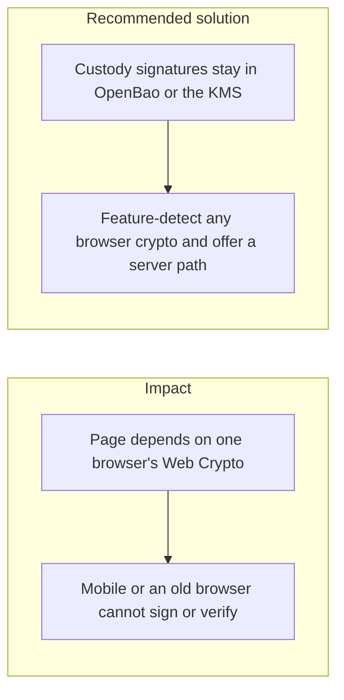

# 037. Cross-Browser and Cross-Device Compatibility

## Problem

`Web Crypto` is not the same on every mobile browser, desktop, and operating system. Secure-context rules, missing algorithms, and non-exportable key handles differ. A flow that generates a long-term key in the page and assumes every browser can sign with it will fail for a slice of users and will tempt a fallback that stores the key in JavaScript.

## Impact

- A user on a mobile browser cannot withdraw, or the app switches to a weaker path that exports the key.
- Verification in the browser accepts a signature the server would reject, or the reverse.
- A non-secure context (`http://` on a hostname that is not localhost) disables `Web Crypto` and the page throws.
- Test coverage on one desktop browser hides the failure.

## Recommended solution

Custody and audit signatures are produced inside OpenBao Transit or the KMS, not in the page, so browser differences do not hold the private key. Any browser-side verify or user-presence check feature-detects `crypto.subtle` and, when it is missing, uses the server verify endpoint rather than a JavaScript reimplementation of the signature scheme. Canonical JSON for anything the client signs matches the server's RFC 8785 bytes. Exercise the flow on a current mobile browser and a current desktop browser before calling it done.
