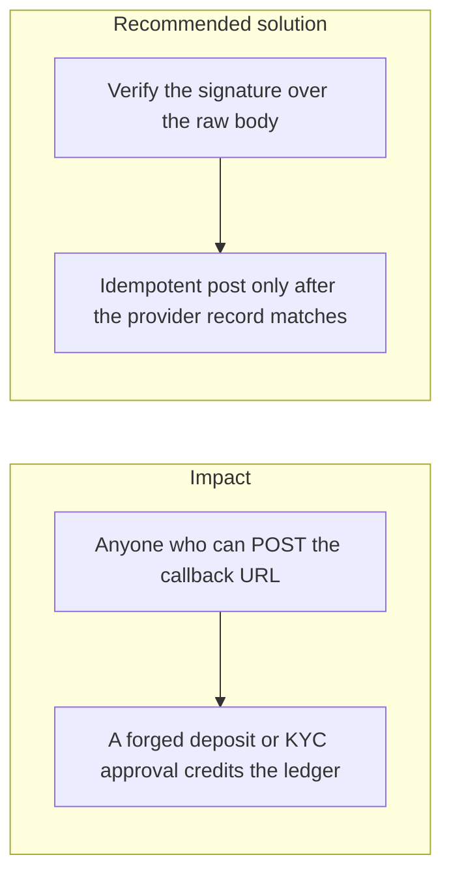
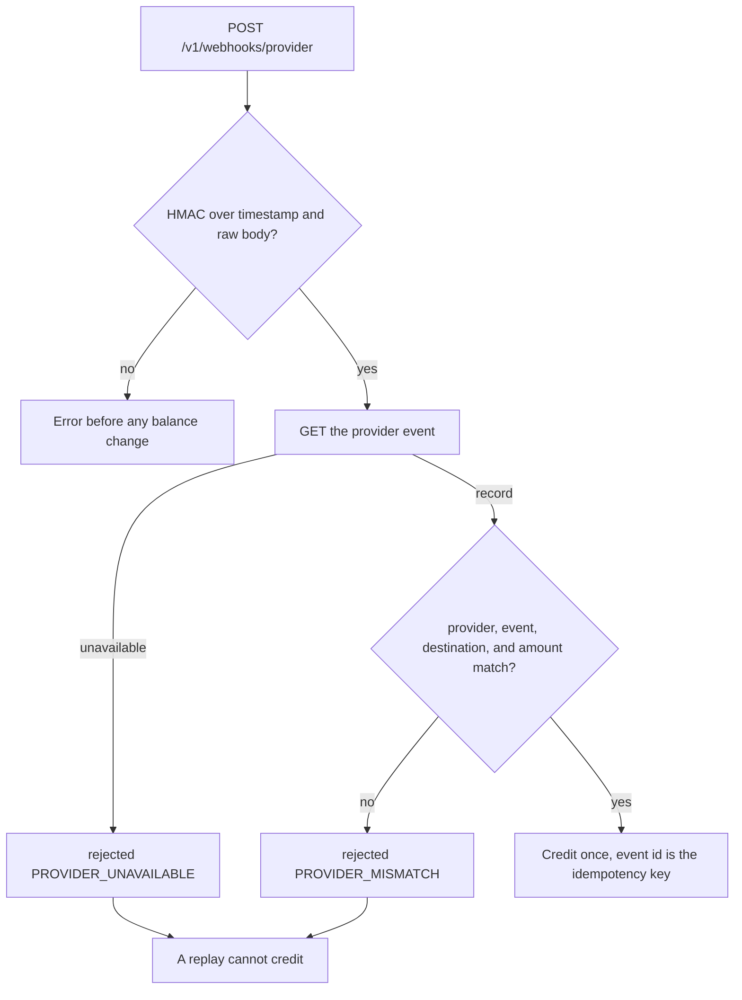

# 038. Webhook and Callback Authenticity



## Problem

A public URL that credits a wallet because the JSON says `deposit succeeded` trusts the caller. Payment and identity providers will retry, send events out of order, and include fields the app does not use. Checking a signature over a re-serialized body, or skipping the signature when the provider name is unknown, accepts a forged event.

## Impact

- An attacker credits their own wallet without paying.
- Ten retries of one real event credit the user ten times.
- A KYC "approved" callback from the open internet raises limits.
- The signature check throws, the handler catches it, and the credit still runs.

## Recommended solution

`POST /v1/webhooks/:provider` is `@Public()` and is the only unauthenticated money-adjacent route, and only because the signature replaces the session. Unknown providers return 404. The MAC is computed over `timestamp + "." + raw body` with that provider's secret, compared with `crypto.timingSafeEqual`, inside a 5-minute window, and a failure returns an error before any balance change. The provider event id is the idempotency key, so sequential and parallel replays post once. The worker loads the provider's own record by event id and posts only when provider, event id, amount, currency, and destination match the signed callback. The same rule is problem 2.17 in the build plan.

## Code



`StripeEventClient` loads the event with `GET {STRIPE_API_BASE}/v1/events/:id` and `Authorization: Bearer ${STRIPE_SECRET_KEY}` before `process` writes ledger entries. The webhook HMAC secret stays `WEBHOOK_SECRET_STRIPE`. A missing key, a failed call, or a body that is not a usable event throws `ProviderEventUnavailable`.

`PaymentsService` compares that record with the signed callback. Provider, event id, and destination must be the same. Amounts compare as money, so `250` and `250.00` match. A mismatch is stored as `rejected` with `PROVIDER_MISMATCH`. A failed retrieve is stored as `rejected` with `PROVIDER_UNAVAILABLE`. Neither writes a ledger entry. The idempotency key is that event id, so a later delivery replays the rejection and cannot credit. A matching record credits once, including a replay. A stored row is returned without calling Stripe again.

```typescript
record = await this.providerEvents.load(
  delivery.provider,
  delivery.event.id,
);
```

```typescript
if (
  providerPaymentMatches(
    {
      provider: delivery.provider,
      eventId: delivery.event.id,
      walletId: delivery.deposit.walletId,
      amount: delivery.deposit.amount,
    },
    record,
  )
)
  return undefined;
return receiptOf(delivery, 'rejected', {
  code: 'PROVIDER_MISMATCH',
  message: 'The provider record does not match the signed callback.',
});
```

```typescript
const url = `${this.baseUrl}/v1/events/${encodeURIComponent(eventId)}`;
let res: Response;
try {
  res = await this.fetchFn(url, {
    method: 'GET',
    headers: { Authorization: `Bearer ${this.secret}` },
    signal: AbortSignal.timeout(TIMEOUT_MS),
  });
} catch {
  throw new ProviderEventUnavailable();
}
```