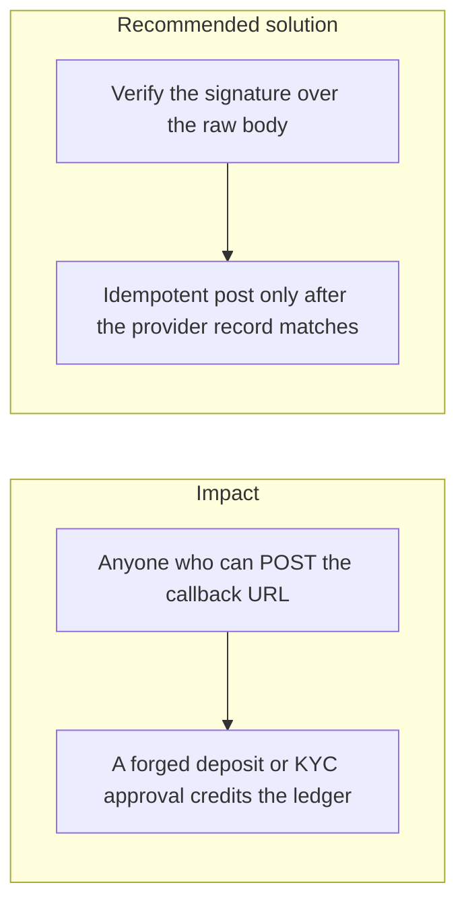

# 038. Webhook and Callback Authenticity

## Problem

A public URL that credits a wallet because the JSON says `deposit succeeded` trusts the caller. Payment and identity providers will retry, send events out of order, and include fields the app does not use. Checking a signature over a re-serialized body, or skipping the signature when the provider name is unknown, accepts a forged event.

## Impact

- An attacker credits their own wallet without paying.
- Ten retries of one real event credit the user ten times.
- A KYC "approved" callback from the open internet raises limits.
- The signature check throws, the handler catches it, and the credit still runs.

## Recommended solution

`POST /v1/webhooks/:provider` is `@Public()` and is the only unauthenticated money-adjacent route, and only because the signature replaces the session. Unknown providers return 404. The MAC is computed over `timestamp + "." + raw body` with that provider's secret, compared with `crypto.timingSafeEqual`, inside a 5-minute window, and a failure returns an error before any balance change. The provider event id is the idempotency key, so sequential and parallel replays post once. The worker loads the provider's own record by event id and posts only when provider, event id, amount, currency, and destination match the signed callback. The same rule is problem 2.17 in the build plan.