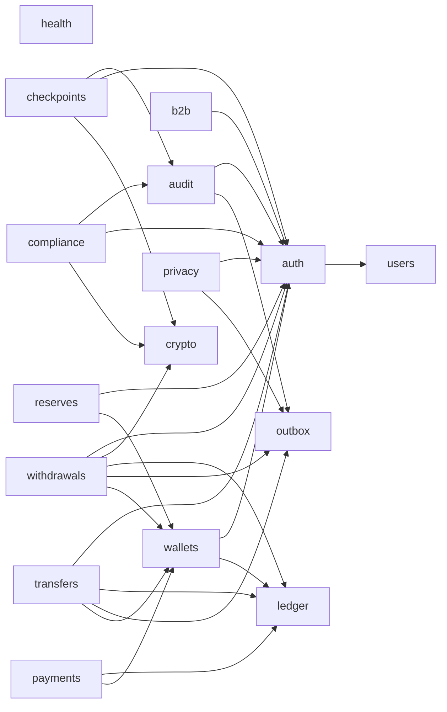

# Module dependency graph

Generated by `npm run modules:graph` from the relative imports under `src/modules/`; do not edit by hand.
An arrow `A --> B` means a file of A imports a file of B. Dashed arrows are type-only imports.
Cycles between modules fail `npm run modules:graph` (file-level cycles fail `npm run lint`).

| From | To | Imports | Type-only |
|---|---|---:|---:|
| audit | auth | 3 | 1 |
| audit | outbox | 14 | 6 |
| auth | users | 2 | 0 |
| b2b | auth | 2 | 1 |
| checkpoints | audit | 2 | 0 |
| checkpoints | auth | 3 | 1 |
| checkpoints | crypto | 3 | 1 |
| compliance | audit | 3 | 0 |
| compliance | auth | 3 | 1 |
| compliance | crypto | 2 | 0 |
| payments | ledger | 6 | 1 |
| payments | wallets | 3 | 1 |
| privacy | auth | 3 | 1 |
| privacy | outbox | 2 | 0 |
| reserves | auth | 3 | 1 |
| reserves | wallets | 3 | 1 |
| transfers | auth | 2 | 1 |
| transfers | ledger | 5 | 1 |
| transfers | outbox | 3 | 1 |
| transfers | wallets | 4 | 2 |
| wallets | auth | 2 | 1 |
| wallets | ledger | 3 | 1 |
| withdrawals | auth | 7 | 3 |
| withdrawals | crypto | 4 | 2 |
| withdrawals | ledger | 4 | 1 |
| withdrawals | outbox | 5 | 2 |
| withdrawals | wallets | 3 | 1 |
